Часы с погодой на рукописном шрифте
===================================

<!-- Заголовок статьи для Хабра: «Живая вода для ESP32: рукописный шрифт и морфинг» -->

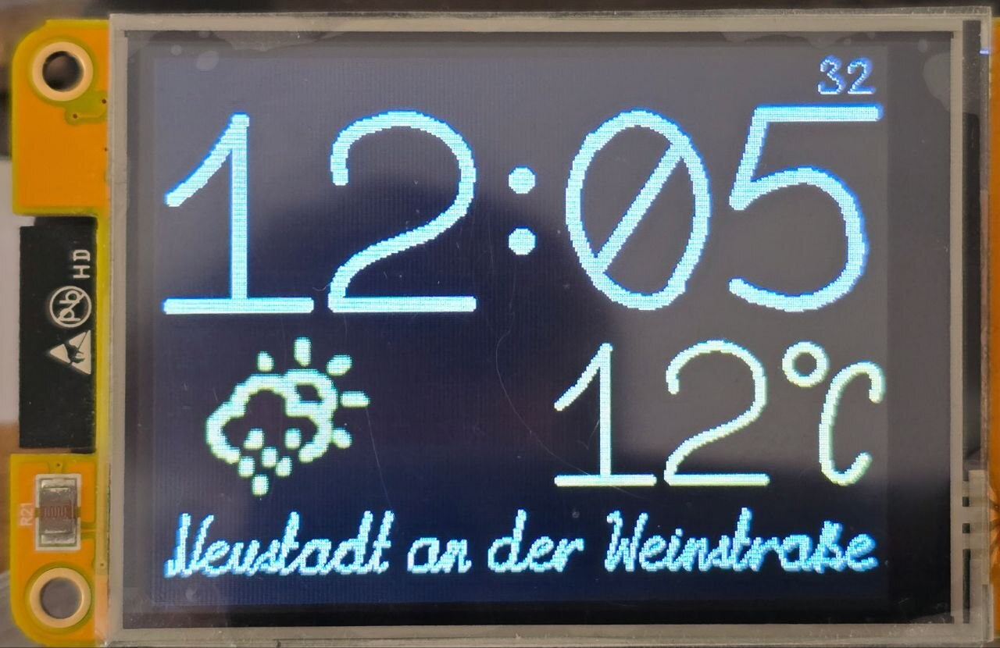

Часы на ESP32 с экраном 320x240. Время, температура и название города написаны
рукописным шрифтом на кривых Безье: цифры времени перетекают одна в другую,
температура и город пишутся штрих за штрихом. Значок погоды собран из точек и
плавно перетекает из одного в другой.

# Мотивация

Часы показывают время, и воспринимается оно мгновенно: взглянул и знаешь.
Оформление делает его заметнее, анимация — живее. Обязательна ли она? Нет. Это
штрих, как в искусстве: без него всё работает, с ним на вещь приятно смотреть.
Статья о том, как такой штрих сделать на микроконтроллере.

<!-- cut -->

## "ОН ПРИКОЛЬНЫЙ ШТРИХ"

После [часов на кривых Безье](https://habr.com/ru/articles/818873/), что я
сделал в 2021 году, возникла идея сделать полностью рукописный шрифт тем же
образом. Готовые форматы, TTF и OpenType,
для этого не подходят не потому, что их тяжело разбирать. Они хранят контур
буквы, границу заливки, а рукописному шрифту нужен путь пера: порядок
штрихов, их направление, где перо отрывается от бумаги и как буква
соединяется с соседней. В контуре этого нет, и восстановить это из него
нельзя. Так что нужен был свой формат: простой, но более универсальный, чем
в тех часах, где любая цифра укладывалась в три кривых, а теоретически, если
пожертвовать красотой, и в две. Пришлось начать с редактора шрифтов,
[hw-fonts](https://github.com/jef-sure/hw-fonts). Он был написан «на скорую
руку» на Vue без каких-либо систем сборки — достаточно открыть `index.html` на
локальном компьютере и можно загрузить ранее записанный шрифт или скачать
результат редактирования (подробнее в разделе [«Редактор»](#редактор)).

Следующим штрихом был морфинг шрифтов, описанных по координатам точек: [часы с
матричным шрифтом](https://habr.com/ru/articles/817927/).

Затем был промежуточный шаг — живой [морфинг в игре
«Жизнь»](https://habr.com/ru/articles/1081830/).

Из этого шага вытекал следующий — [морфинг между глифами
шрифта](https://github.com/jef-sure/cyd-dotview-morphing), хотя шрифт выступал
скорее просто в роли источника, и в реальности это морфинг между любыми двумя
матрицами. Процесс разработки протекал от идеи к идее, формируя разные возможные
стратегии. Из этого вырос отдельный фреймворк морфинга между матрицами в
[dgx](https://github.com/jef-sure/esp32-component-dgx) (подробнее в разделе
[«Матричный морфинг»](#матричный-морфинг)).

И всё это ради «прикольного штриха». Просто потому, что мне нравится оживлять
информацию, просто потому, что мне нравится программирование как вид искусства.
Микроконтроллеры накладывают свои ограничения, и это становится вызовом: как их
преодолеть.

Предупреждение: текст длинный. От зарождения идеи прошло 5 лет, эксперименты
и поиск идей длились долго, и если укорачивать изложение, потеряется связность.

# Часы 2021 года

Идею подсмотрел в канале о программировании ESP32: человек показал часы на шести
дисплеях, по цифре на каждом, и назвал источник — проект Bézier Clock на
JavaScript разработчика Jack Frigaard. Про исходный проект на Хабре есть статья
[Часы на кривых Безье](https://habr.com/ru/articles/236455/). Как именно там
сделано, я не смотрел: сразу решил делать по-своему и сначала проверил, как
превращение выглядит на дисплее. [Код того
эксперимента](https://github.com/jef-sure/digits_morping_dgx) сохранился, видео
с ним стоит ниже, в разделе про пары кривых.

В моих часах каждая цифра состояла из трёх кубических кривых Безье. Для начала я
определил, что все символы должны влезать в поле 100x160, с учётом того, что
опорные точки могут вылетать за эту сетку, но оставаться в пределах 0–255, чтобы
каждая координата помещалась в `uint8_t`: так я пытался сократить описание
масштабируемого шрифта до нескольких байт. Редактора для подобных шрифтов не
нашлось, поэтому опорные точки я просто мысленно представлял себе в голове и
экспериментально проверял, насколько они удовлетворяют. Получилось не так уж
плохо, все цифры были подобраны довольно быстро. К идеальным линиям я не
стремился, и это была одна из причин скорости такого подбора только воображением
поля.

[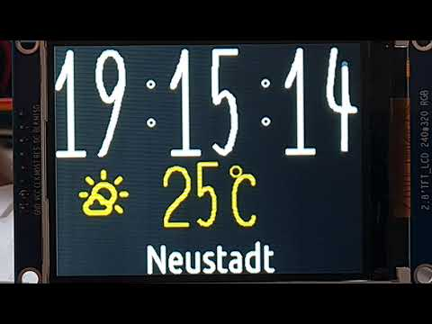](https://www.youtube.com/watch?v=7H-2-X1M7PA)

После тех часов остались вопросы. Пароль от WiFi и ключи сервисов задавались в
`sdkconfig`. Это был в те годы принятый стандарт, так делали в статьях, журналах
и руководствах: ты просто описываешь необходимые параметры в Kconfig, задаёшь
SSID и пароль в menuconfig, а в программе пользуешься ими как константами из
`sdkconfig.h`. Схема хорошо подходит для своего личного проекта, но если ты
хочешь сделать кому-то подарок, то придётся либо научить человека компилировать
твою прошивку, либо спросить его WiFi и пароль к нему. Прямо скажем, не очень-то
хорошая схема.

Второй вопрос — автоматическое определение города. Проблема та же, для погоды
нужно определённое место, задавать его через Kconfig — та же проблема. В итоге,
решил воспользоваться сервисом определения места по IP-адресу. В моём случае
дома он часто угадывал, иногда говорил соседний город. Но в чужой сети мог
показать город за несколько сот километров.

Третья проблема связана со второй — часовой пояс. Хорошо, что тот же сервис его
возвращает, так что частично она всё-таки решается. Но по-хорошему полагаться на
сторонний сервис для часового пояса... А если ключ от него неизвестен или
перестал работать?

Матричный шрифт не проблема — я написал конвертер `font2c`, который
через FreeType растеризует шрифт в монохромный вариант и пишет необходимые мне
`Arial12.h` и `Arial12.c` для добавления в проект. Проблемой оказался
растеризатор, не все шрифты хорошо получаются в монохромном виде. Так что
пришлось подбирать. Длина названия города может занимать разное число символов,
так что пришлось придумать оценку размера названия города для заданного шрифта,
чтобы подобрать максимально подходящий. Масштабирование для матричных шрифтов я
тогда не изобрёл...

Возникла идея рукописного шрифта: тем же способом, что и цифры, кривыми, которые
масштабируются как угодно. Рисовать буквы в голове, как цифры, уже не выходило,
и так появился редактор hw-fonts, о котором сказано выше. В нём я нарисовал
латинский шрифт, и на этом тема подвисла на несколько лет.

Остановился я на стыках букв. Рукописный текст пишется слитно, и переход от
одной буквы к другой должен быть гладкой кривой, которая подстраивается под
соседа. Если просто приставить хвост одной буквы к началу другой, на что я
рассчитывал изначально, в месте стыка получается излом или лишняя петля, а точек
выходит больше, чем нужно кривой. Решения тогда не нашлось. Отложил тему «до
лучших времён».

В 2026 году шрифт дорисован до русского алфавита, в графической библиотеке
[dgx](https://github.com/jef-sure/esp32-component-dgx) появилась поддержка таких
шрифтов, а этим часам досталась роль первого проекта на них. Вопросы с
настройкой, местом и часовым поясом закрыты тут же, об этом в разделе про
настройку.

Рукописный текст в dgx на видео, ещё без часов:

[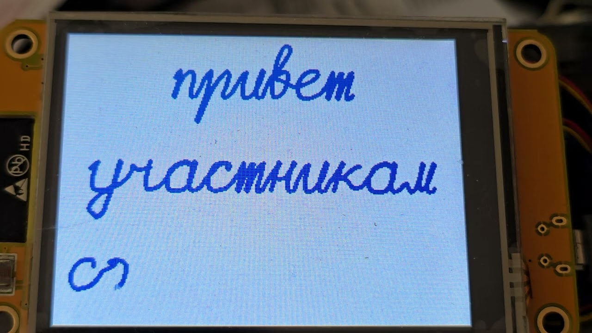](https://youtu.be/3zXTnylonLs)

# Кривые Безье на микроконтроллере

Кубическая кривая Безье задаётся четырьмя точками: две крайние и две, к которым
кривая тянется. Изогнуться она может дважды, в разные стороны, как буква S. В
рукописном шрифте есть и квадратичные кривые, по трём точкам: две крайние и
одна, к которой кривая тянется. Такая кривая — дуга параболы, изгибается она
только в одну сторону. Где этого хватает, она проще в рисовании и в редакторе.
Подробно — в
[Википедии](https://ru.wikipedia.org/wiki/%D0%9A%D1%80%D0%B8%D0%B2%D0%B0%D1%8F_%D0%91%D0%B5%D0%B7%D1%8C%D0%B5).

Рисунок: Chris828, Wikimedia Commons, общественное достояние.

Буква из таких кривых — это несколько штрихов, каждый своей кривой, и на бумаге
с ними всё просто. На микроконтроллере трудностей три, и статья по сути про
них.

Первая: отрезки. Микроконтроллер умеет рисовать прямые, и кривая — это
сколько-то отрезков прямых. Мало отрезков — видны углы, много — долго. Сколько
нужно, зависит от кривизны и от размера на экране, и ответ у каждой кривой
свой.

Вторая: толщина. Линия нужна толстая, а толстый отрезок — это не линия, а
фигура. На стыке двух отрезков с внешней стороны поворота остаётся клин, и его
надо чем-то закрыть. В 2021 году его закрывал круг на каждом стыке, и круги
съедали до половины времени рисования даже в виртуальном экране.

Третья: анимация. Кадр превращения — каждый раз новая картинка, и рисовать её
прямо на дисплее нельзя: видно, как стирается старое и появляется новое. Значит,
кадр рисуется в памяти, на виртуальном экране, и переносится на дисплей по SPI.
Полоса часов и минут 320x100 в два байта на пиксель — 64 КБ, и по шине на 40 МГц
она идёт 17 мс. Из 520 КБ SRAM у ESP32 приложению достаётся около 300, и в них
же живут WiFi и TLS; экран 320x240 в два байта на пиксель занял бы половину.
Если бы в куче вообще нашёлся такой непрерывный участок, пригодный для прямой
передачи по DMA.

Как я с ними справлялся, рассказано ниже, в «Графике» и в «Морфинге», но до
них ещё далеко: сначала про сам шрифт, без него рисовать нечего.

# Шрифт

Шрифт `font0ss` нарисован мной в редакторе и входит в dgx. В нём латиница с
немецкими буквами, русский алфавит, цифры и знаки: 153 символа, 686 элементов
четырёх видов.

| Вид | Точек | Что это |
| --- | --- | --- |
| `curve` | 4 | кубическая кривая Безье: начало, две опорные точки, конец |
| `curve3p` | 3 | квадратичная кривая Безье: начало, одна опорная точка, конец |
| `line` | 2 | отрезок |
| `dot` | 1 | точка |

Кубических кривых подавляющее большинство, 619 из 686. Остальные виды там, где
кубическая избыточна: черта у «7» — это отрезок, точки над «ё» — точки.

## Редактор

Контурные шрифты пути пера не хранят, поэтому свой формат и свой редактор.

[Редактор hw-fonts](https://github.com/jef-sure/hw-fonts) написан в 2022 году
на Vue и Vuex; на Pinia он переделан недавно, когда я к нему вернулся.
Библиотеки подключаются готовыми скриптами с CDN, шрифт хранится в файле
JSON. Первое время, когда надо было делать похожие буквы, я просто копировал
описания соответствующих JSON-частей в новый codePoint.

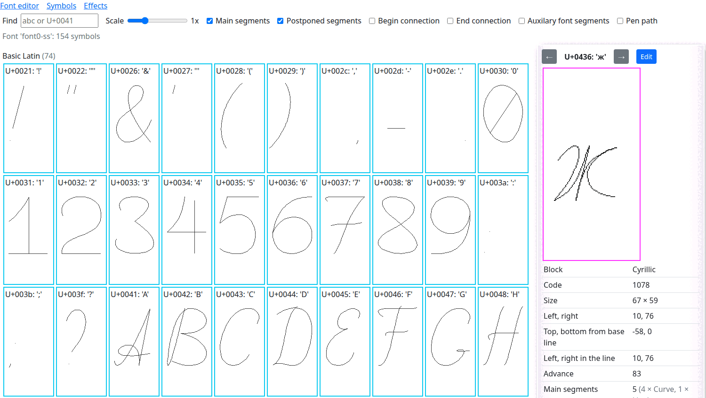

Сетка 256x256, координаты целые, от 0 до 255: точка умещается в два байта, по
байту на ось, как и в часах 2021 года. Тогда это было задумано ради памяти,
теперь скорее привычка, но микроконтроллеру она удобна: на той стороне точки
умножаются на масштаб и рисуется ломаная, дробям там делать нечего. Внутри
сетки активная область, в `font0ss` 100x202 клетки: ширина знакоместа и
высота строки. Вокруг неё поля, туда выходят опорные точки кривых и хвосты
букв, которые заходят к соседям.

У символа в редакторе четыре набора элементов, и у каждого своя роль при
письме. Основные штрихи — сам рисунок буквы, в том порядке, в каком их ведёт
рука. Отложенные штрихи — то, что рука ставит, когда слово дописано: точки над
«ё», перекладина «t», черта у «7». Связь на вход и связь на выход — штрихи,
которыми перо приходит в букву от предыдущей и уходит к следующей; в рисунок
буквы они не входят, это переходы. Связи есть у строчных на обе стороны, у
заглавных только на выход, у «V» и «W», цифр и знаков их нет.

Кроме символов, в файле лежат вспомогательные линии, общие для всего шрифта:
горизонтали на высоте заглавных и строчных, две наклонные для наклона и две
вертикали для границ буквы. Это направляющие, по которым я выдерживал
одинаковые высоты и наклон у всех букв. В символы они не входят и на
микроконтроллер не попадают.

Всё, что можно посчитать заранее, редактор считает при сохранении: размеры
символа, длину каждого штриха и число отрезков, которыми его рисовать.
Микроконтроллеру остаётся читать. Длина и число отрезков нужны не только для
рисования: из них складывается трудоёмкость штриха, по которой перо потом
пишет с разной скоростью на прямой и на завитке, об этом в разделе
[«Перо»](#перо).

## Путь пера

Символ — это штрихи в том порядке, в каком их ведёт рука, и порядок здесь не
формальность. Шрифт задуман так, чтобы текст можно было писать, как пишет
рука: буква за буквой, штрих за штрихом. Поэтому точка над «i» не может быть
частью буквы: рука ставит её, когда слово дописано. При слитном письме конец
одной буквы и начало следующей соединяются одной кривой; цифры пишутся
отдельно, связей у них нет.

Я старался обходиться наименьшим числом кривых на символ, даже в ущерб точности
формы: на основной рисунок, без связей и отложенных штрихов, уходит в среднем
три элемента, самое большее семь. Причин три. Чем меньше кривых, тем меньше
считать на микроконтроллере. Тем проще морфинг: превращать три кривые в четыре
легче, чем двадцать в тридцать. И тем меньше рисовать: это крайне трудоёмкое
дело, на один латинский шрифт у меня ушёл месяц, и к концу я устал и чувствовал,
что выдохся.

Буква «i» в редакторе. Основной штрих один, точка записана отдельно, как
отложенный штрих. Слева и справа от буквы видны её связи, на вход и на выход:

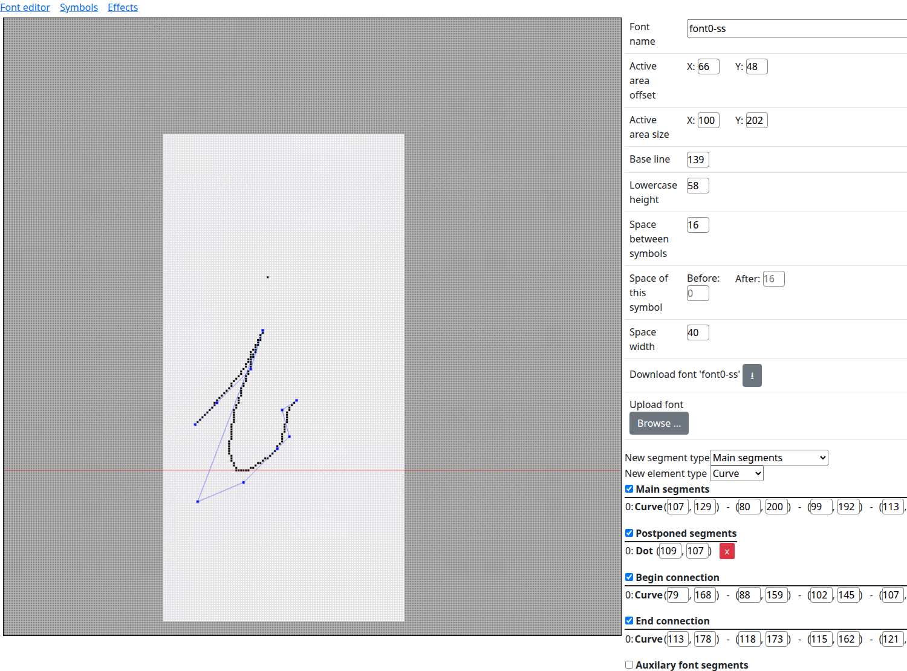

## Стык букв

Связь у буквы нарисована руками в редакторе, отдельно на вход и на выход, и
состоит из обычных штрихов шрифта. Как из конечной связи одной буквы и
начальной связи другой получить одну гладкую кривую, я в 2022 году так и не
решил: у двух кубических кривых восемь опорных точек, у одной четыре, и всё,
что я пробовал, давало либо излом, либо петлю. На этом работа и встала.

Решение в итоге такое. Последний штрих связи на выход и первый штрих связи на
вход следующей буквы сливаются в один. Два их конца, которые встречаются в
зазоре между буквами, из восьми точек выпадают, а две опорные точки при этих
концах сливаются в одну, посередине между ними. Остаётся пять точек: концы
связей, точки направления при них и эта середина. Это кривая четвёртой степени,
а шрифт рисует только кубические, поэтому вместо неё берётся ближайшая
кубическая. Её концы — концы связей, две средние точки лежат на тех прямых, по
которым связи нарисованы: перо уходит из одной буквы и приходит в другую в
заданных направлениях. Как далеко по этим прямым отстоят средние точки,
подбирается по наименьшему отклонению от кривой из пяти точек, в семи её точках.
Связь, которой не с чем соединиться, не пишется: слово не начинается и не
кончается висящим хвостиком.

Так это выглядит на двух парах из `font0ss`. Серым — буквы и остальные штрихи
их связей, пунктиром — два штриха, которые сливаются, с их опорными точками,
точками — кривая из пяти точек, чёрным — кубическая, которой стык рисуется.

У «и» и «м» концы связей сходятся в одной точке, и стык почти повторяет
нарисованные связи:

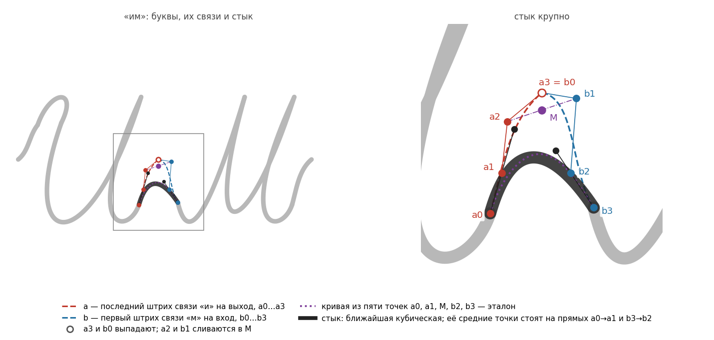

У «к» и «е» они расходятся: хвост «к» нарисован вверх, к `a3`, а начало
связи «е», `b0`, лежит ниже. Если бы перо шло по хвосту до конца, а потом в
«е», получилась бы петля. Стык оба конца выбрасывает и идёт напрямую, а
эталон из пяти точек и кубическая почти совпадают, в этом и смысл подбора:

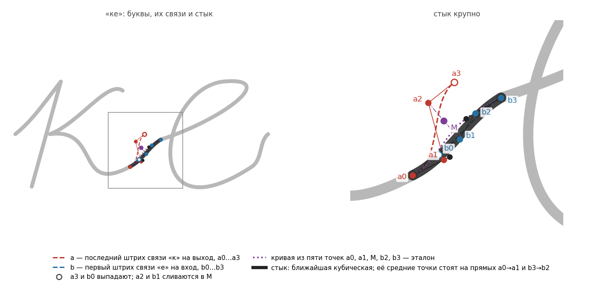

Буква «ж» со связями. Чёрное — сами штрихи на сетке, синие точки и тонкие
линии — опорные точки кривых. Связь на вход подходит к букве слева, связь на
выход уходит от неё справа вверх:

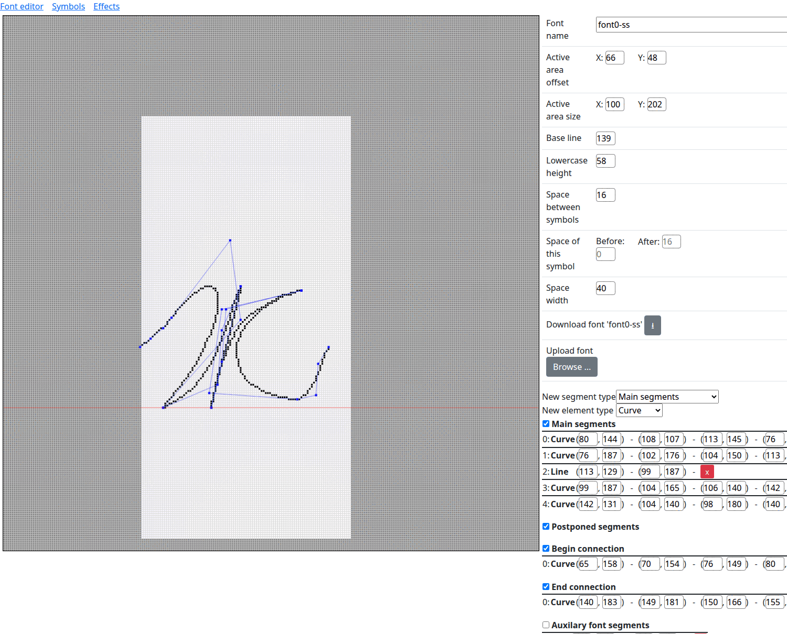

## Единицы и масштаб

Шрифт нарисован на сетке редактора, и все его числа — номера клеток этой
сетки, а не пиксели: буква «о» в `font0ss` шириной 49 клеток. Размера у шрифта
поэтому нет. Он появляется при выводе: все координаты умножаются на одно
дробное число, и получаются пиксели. Это число и есть масштаб, и единица для
него ничем не выделена: при масштабе 0,5 та же «о» займёт на экране 25
пикселей, при 0,33 — 16, при 2 — 98. Один и тот же шрифт годится и для строки
секунд, и для заставки на весь экран.

Толщины линии в шрифте тоже нет: штрихи — это кривые без ширины, как линии
на чертеже. Толщину задаёт перо: при выводе вместе с масштабом передаётся,
сколько пикселей в ширину у линии. Перо от масштаба не зависит: одну и ту же
букву одного размера можно написать и тонко, и жирно.

Масштаб можно задать свой по ширине и по высоте. Если он один и тот же, буква
получается такой, как нарисована, только крупнее или мельче.

## Масштаб в часах

Температура рисуется с одним масштабом на обе оси. Название города тоже,
пока влезает в своё место по ширине; длинное название не уменьшается, а
сжимается по горизонтали, высота букв остаётся, и перо худеет вместе с ним.
Короткое название при этом на всю ширину не растягивается. У цифр времени
масштаба два всегда, по ширине и по высоте, и считаются они от места на
экране. Строка часов и минут делится на знакоместа, по одному на цифру.
Самая широкая цифра шрифта должна влезть в знакоместо по ширине, самая
высокая — в строку по высоте; отсюда два числа: сколько пикселей в клетке по
горизонтали и сколько по вертикали. Пропорции шрифта при этом не сохраняются.

Растягиваются при этом только опорные точки: `x` умножается на один масштаб,
`y` на другой, а перо остаётся круглым и одной толщины во всех направлениях.
Поэтому у растянутой цифры вертикальные и горизонтальные линии одинаковы, а
не как у надписи, растянутой в графическом редакторе, где горизонтальные
штрихи жирнеют.

Толщину пера часы выбирают сами, и привязывают её к масштабу уже они, а не
шрифт: перо считается как 9 клеток шрифта, умноженных на масштаб, чтобы линия
росла и убывала вместе с буквой. При масштабе 0,5 это 4–5 пикселей, при
масштабе 2 — 18. Когда масштабов два, берётся среднее геометрическое: на
экране 320x240 выходит 6 пикселей у часов и минут и 1 пиксель у секунд.

Цифры разной ширины, единица уже нуля. Знакоместо для всех одно, а цифра
сдвигается в его середину, поэтому время не ездит по экрану, когда единица
сменяет ноль.

Для рукописных букв такое растяжение не годится: при разном масштабе по осям
поплыли бы наклон и округлости, и это заметно. Цифрам можно: в `font0ss` они
прямые и ровные, для рукописных даже слишком, зато хорошо читаются издалека
и растягиваются по высоте без вреда.

## Из редактора в микроконтроллер

JSON — формат редактора, универсальный и удобный для правки, и разбирать его
на микроконтроллере незачем. Утилита `font2c` из dgx превращает файл в таблицы
на C: те же данные под теми же именами, в прошивке весь шрифт занимает 17 КБ.
В неё и раньше попадали шрифты TTF, так в часы попали значки погоды; теперь
попадают и рукописные. Заодно `font2c` проверяет пары символов: ставит каждый
после каждого так, как их ставит строка, и называет пары, у которых линии
ближе толщины пера. По этому списку в шрифте раздвинуты «7» и строчные после
неё, «Ф», скобки и знаки препинания.

# Перо

Письмо — это текст, нарисованный не весь, а до того места, куда дошло перо, и
место это со временем уходит вперёд. Стирать ничего не надо: перо только
добавляет чернила, каждый шаг рисует новое, и текст, дописанный за любое число
шагов, пиксель в пиксель совпадает с текстом, нарисованным сразу.

Вопрос в том, чем мерить место пера: что значит «перо прошло половину»?

## Трудоёмкость

Первое, что приходит в голову, — параметр кривой: у каждого штриха `t` идёт от
0 до 1, и перо стоит в точке `t`. Не годится сразу: параметр по кривой Безье
идёт неравномерно, а штрихи различаются по длине во много раз, и длинная
прямая с коротким завитком заняли бы одно время. Перо то летело бы, то ползло.

Второй вариант честнее — длина пройденного пути. Перо идёт с ровной скоростью,
но рука так не пишет: на прямой она быстрая, на завитке медленная. Ровное
письмо на экране выглядит механическим, как плоттер, и мне это не понравилось.

Поэтому я ввёл третью меру, трудоёмкость: длина плюс плата за изогнутость. У
каждого штриха она своя:

    трудоёмкость = длина + k × число отрезков

Длина — это путь пера по штриху. Число отрезков — мера изогнутости: чем круче
кривая, тем больше прямых отрезков нужно, чтобы её нарисовать. Коэффициент `k`
говорит, во сколько единиц пути обходится каждый отрезок. При `k = 0` это
второй вариант, перо идёт ровно.

Коэффициент подбирал на глаз, по тому, как письмо выглядит на экране; в часах
`k = 6`. Пример из `font0ss`. У единицы путь 271,
отрезков 5. У буквы «о» путь короче, 208, зато отрезков 23. При ровной скорости
единица писалась бы дольше. При `k = 6` трудоёмкость единицы 301, а «о» — 346,
и круглая буква пишется дольше трёх почти прямых штрихов, как у руки.

У точки длины нет, а время на неё уходит. Ей и каждому переносу пера по воздуху
назначена наименьшая трудоёмкость, такая же, как у дефиса: 44.

Длину и число отрезков микроконтроллер не считает. Штрих не меняется, поэтому
оба числа один раз считает редактор шрифтов, когда сохраняет шрифт, и
записывает рядом со штрихом. Микроконтроллеру остаётся прочитать их и сложить.

## Темп

Перо тратит трудоёмкость с постоянным темпом. Цифры часов и минут пишутся с
темпом 3000 единиц в секунду, город и температура — 1500. Время, прошедшее с
начала письма, умноженное на темп, говорит, сколько перо уже потратило, а
значит, где оно сейчас. Сколько бы кадров ни было нарисовано к этому моменту,
перо стоит там, где положено по времени. Тот же приём у превращения цифр, о
нём ниже.

От потраченной трудоёмкости до пикселя три шага. Сначала находится штрих, на
который она приходится: все штрихи до него закончены. Потом место на этом
штрихе, и считается оно по пути вдоль ломаной, а не по параметру кривой, чтобы
перо не ползло и не прыгало на отрезках разной длины. Наконец, отрезок под
пером рисуется до того места, куда оно дошло, с круглым кончиком.

Время письма от масштаба не зависит. Трудоёмкость считается в единицах шрифта,
а не в пикселях, поэтому крупный текст пишется столько же, сколько мелкий:
перо на экране просто идёт быстрее. Зависит оно только от самого текста и от
темпа. «Frankfurt am Main» при темпе 1500 единиц в секунду перо пишет 5,2
секунды, при темпе 3000 писало бы 2,6.

## Что пишет перо

Пером пишется:

  1. Время при включении, цифра за цифрой, примерно за секунду. Дальше цифры
     только перетекают;
  2. Название города, буква за буквой;
  3. Температура. Меняется она редко, поэтому морфинг ей не нужен. Знаки,
     которые изменились, перо сначала стирает тем же путём, каким писало, вдвое
     быстрее, потом пишет новые. Знак градуса стоит у правого края, цифры и
     минус перед ним — на постоянных местах;
  4. Буквы «Z» и «W» в верхней строке, пока часы после включения ждут время и
     погоду: перо пишет букву, стирает и пишет снова.

Стирания как такового при этом нет, это искусственный приём: чтобы убрать
написанное, перо пишет то же самое ещё раз, тем же путём и той же толщины,
только чернилами цвета бумаги.

Знака «℃» в шрифте нет. Он собран на месте: кольцо в левом верхнем углу и узкая
буква «C» из шрифта, вместе в размер одной цифры.

Минус перед числом — не дефис. Дефис в шрифте стоит посередине строчных букв,
там ему и место в названии вроде «Ростов-на-Дону». Перед цифрами он оказывается
слишком низко и выглядит как подчёркивание, сползшее вверх. Поэтому в `font0ss`
есть отдельный знак минуса: черта на середине высоты цифр, на 31 единицу выше
дефиса. Шрифт сам одно на другое не заменяет, минус ставит код, который пишет
число: в температуре стоит «−», а в названии города остаётся «-».

Включение на видео: перо пишет время и название города, значки в верхней
строке показывают, чего часы ещё ждут. Сначала подключается WiFi, затем приходит
погода, последним — время из сети.

[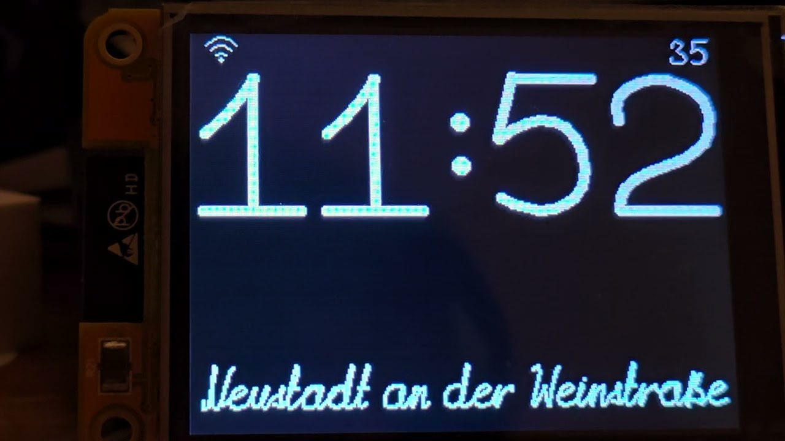](https://youtu.be/5kWO57Guf_s)

# Морфинг

Превращение одной цифры в другую устроено так же, как в 2021 году. Опорные точки
кривой идут по прямой со старого места на новое: `P(t) = Pa + t*(Pb - Pa)`. По
новым точкам строится кривая и рисуется как любая другая.

Для этого кривые у обеих цифр должны быть одного вида, а в шрифте штрихи
разные: точки, прямые, квадратичные и кубические кривые. Поэтому перед
превращением все они приводятся к кубическим. Прямая и квадратичная кривая
повышаются до кубической без изменения формы, точка становится кривой, у
которой все четыре точки в одном месте. После этого цифра — список кубических
кривых, а превращение — список пар таких кривых.

## Пары кривых

В 2021 году у каждой цифры было ровно три кривые, и шли они в том порядке, в
каком удобны для морфинга: первая в первую, вторая во вторую. Так это выглядело
в первом эксперименте, цифры перетекают одна в другую по кругу:

[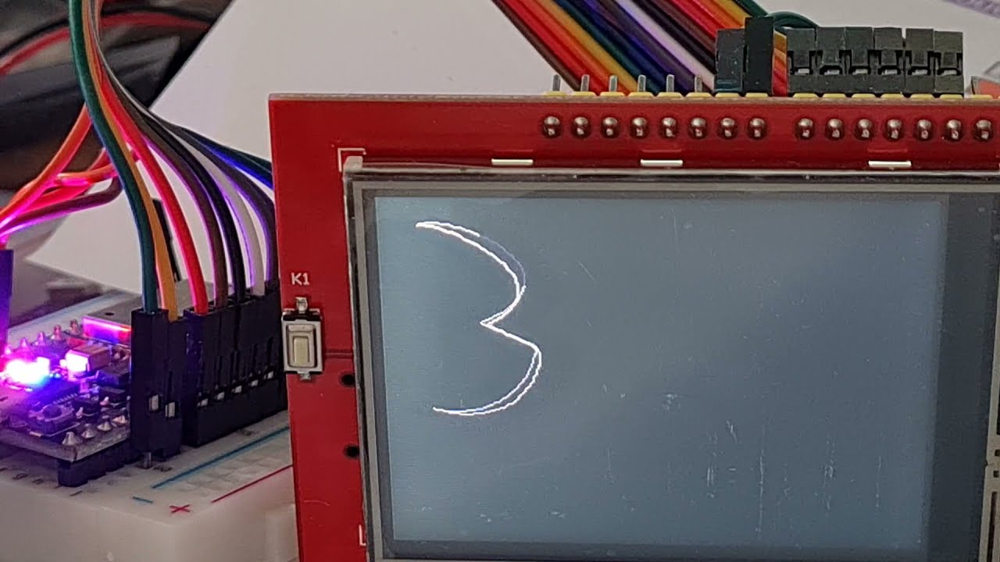](https://youtu.be/dXjHZpKN25c)

В шрифте порядок другой: цифра нарисована так, как её пишет рука, и когда цифры
часов взялись из шрифта, превращение стало заметно хуже, и я не сразу понял
почему. Порядок письма для пар не годится: у девятки сначала овал и в конце
хвост, у семёрки сначала верх, и верх одной летел вниз, чтобы стать хвостом
другой. Поэтому пары теперь выбираются перебором так, чтобы все точки вместе
прошли наименьший путь. Кривую при этом можно взять с другого конца, рисует она
то же самое. У цифр `font0ss` путь выходит в среднем на 30% короче, чем по
порядку письма, а при переходе двойки в девятку — вчетверо.

Перебор дешёвый: лучший путь считается по множествам уже занятых штрихов, их
2^n, а не n!, а штрихов у цифры единицы. Символ с более чем десятью штрихами
dgx отправил бы в пары по порядку письма.

Число штрихов у цифр разное, и пара находится не каждому. Лишнему штриху в пару
ставится точка: кривая, у которой все четыре опорные точки совпали, в том месте,
где перо закончило писать цифру. Дальше это обычная пара: лишний штрих старой
цифры за время превращения стягивается в эту точку, лишний штрих новой из неё
вырастает.

## Место

Сдвиг цифры до середины знакоместа зависит от её ширины, поэтому у старой и
новой цифры он разный. Он меняется вместе с `t`: единица, превращаясь в ноль,
заодно переезжает на его место.

## Время

Превращение часов и минут длится полсекунды и заканчивается ровно к
наступлению секунды, которая показана на экране. Остальные полсекунды
картинка стоит: глазу нужно время, чтобы её прочитать. У секунд сначала было
так же, но мне показалось, что темп для цифры, которая меняется каждую
секунду, всё-таки немного завышен, и я сдвинул его: секунды превращаются за
0,3 секунды и стоят 0,7.

Параметр `t` в формуле — это доля пройденного пути: при 0 на экране старая
цифра, при 1 новая, между ними промежуточная форма. Считается он из времени:
сколько прошло с начала превращения, делённое на его длительность. Четверть
секунды после начала это `t = 0.5`, сколько бы кадров к этому моменту ни было
нарисовано. Если кадр рисовался дольше обычного, следующий просто окажется чуть
дальше по пути, а закончится превращение вовремя.

В кривые идёт не сама эта доля, а сглаженная известной формулой smoothstep:
`t*t*(3 - 2*t)`. В начале и в конце она меняется медленнее, чем в середине, и
цифра трогается и останавливается плавно.

## Кадр

Кадр превращения — каждый раз новая картинка, прежнюю надо убрать. Поэтому цифры
рисуются на виртуальном экране и уходят на дисплей готовыми, без мерцания.
Кадров столько, сколько успевает: около ста за полсекунды, когда меняется
одна цифра часов или минут.

Стирается и рисуется заново только знакоместо той цифры, которая меняется.
Цифра по дороге к следующей из своего знакоместа не выходит: проверено на
плате для всех 90 пар цифр, в обоих размерах. Остальные цифры и двоеточие
остаются как были нарисованы, и на дисплей уходит только это знакоместо.

Строк две: часы с минутами и секунды. Строка с минутами превращается раз в
минуту, строка с секундами — каждую секунду (Капитан Очевидность передаёт
привет), и пока идёт превращение, строка перерисовывается кадр за кадром.

Секунды мелкие, в шестую часть высоты часов и минут, в углу над минутами.
Крупные секунды всё время движутся, и глаз за них цепляется: посмотрел на часы
и залип. Убирать их совсем не хотелось, иногда секунды нужны. В таком размере
их видно, если искать, и они не отвлекают.

# Матричный морфинг

Второй вид морфинга в часах — не кривых, а точек: так перетекает значок погоды.
Он пришёл не из часов 2021 года, а по другой ветке, из трёх проектов подряд.

Сначала были [часы с матричным шрифтом](https://habr.com/ru/articles/817927/)
на двух OLED-дисплеях. Каждый символ там описан координатами точек, и порядок
точек в списке — это и есть хореография: точка с номером `i` одного символа
летит в точку с номером `i` другого, а если точек у символов разное число,
короткий список дополняется повторами последней точки. У восьмёрки, например,
точек больше, чем у девятки, и при переходе лишние точки левой нижней дуги
просто сжимались в нижнюю точку девятки. Порядок подобран так, чтобы
неизменяемые части при переходе оставались на тех же местах. Цифры и пару
символов для градусов я сделал сам. За основу значков погоды взял шрифт
с иконками погоды и руками доработал их в редакторе
[FontCreator](https://github.com/Llerr/FontCreator), который позволяет при
редактировании символа указать индекс каждой точки.

Следующим был эксперимент с [игрой
«Жизнь»](https://habr.com/ru/articles/1081830/). Обычно в ней одно поколение
просто сменяет другое, кадр за кадром. Мне хотелось, чтобы оно в него
перетекало, и так появилось «живое перетекание». Расставлять точки руками здесь
не нужно, правила игры сами говорят, кто куда летит. Клетка рождается, когда у
неё ровно три живых соседа. Они и есть её родители, и от каждого в новую клетку
летит точка. В одну клетку прилетают сразу три точки, и чтобы она не
пересветилась, яркость делится между ними поровну.

Третьим шагом был [морфинг пары произвольных
символов](https://github.com/jef-sure/cyd-dotview-morphing) обычного растрового
шрифта. У пары символов нет ни порядка точек, ни правила рождения, поэтому
источник для каждой новой точки подбирается сам, по геометрии. Шрифт здесь
только источник точек: превращение осуществляется между любыми двумя матрицами.
Из этих трёх проектов и вырос фреймворк в dgx: матрица клеток, план «кто куда
летит», кадр и рендерер со свечением, а проекту остаётся сказать, откуда брать
следующее состояние и как выбирать источники.

Клетка либо горит, либо нет, и при переходе от одной матрицы к другой с её
состоянием возможны четыре случая. Не горела и не горит: ничего не
происходит. Горела и горит: точка стоит на месте. Не горела и загорелась:
точка откуда-то прилетает. Горела и погасла: точка уходит. Вопросов два:
откуда прилетает новая точка и куда уходит старая.

На первый вопрос ответ такой: новая точка прилетает от ближайшей точки старого
символа, которая ещё никому не служит источником. Годится и точка, которая сама
никуда не двигается: она остаётся гореть на месте и вдобавок отпускает от себя
новую. Так «u» превращается в «ü»: вся буква остаётся гореть, а точки над ней
отпочковываются от верхушек её стоек. Источником каждая старая точка служит один
раз. Ищется ближайшая не для каждой точки по отдельности, а сразу для всей
матрицы, вектор за вектором. Вектор здесь — это сдвиг, например на клетку вверх.
Берётся один вектор, и каждая новая точка смотрит, нет ли в старом символе
свободной точки ровно на этом сдвиге от неё. Потом следующий вектор, от коротких
к длинным, пока у всех новых точек не найдётся источник или пока не кончатся
свободные старые. Линия, сдвинувшаяся вбок, находит всю свою старую линию одним
вектором и едет целиком, а не рассыпается. Новая точка, которой источника не
досталось, появляется из центра матрицы. Старая точка, которую никто не взял и
которой нет в новом символе, остаётся лишней: это второй вопрос, о нём ниже.

Так было не сразу. Сначала проходов было два: соседи, а потом, клетка за
клеткой, сразу все кольца, и клетка в начале обхода могла забрать источник за
четыре клетки от себя, который у следующей был в трёх. После переделки на
векторы полёты стали в среднем короче: 4,1 клетки вместо 5,0. Измерял я на
значках погоды, тех самых, что показывают часы.

Им поиск по векторам и пригодился больше всего. Значки взяты из шрифта [Weather
Icons](https://erikflowers.github.io/weather-icons/) и, к сожалению, не
выровнены между собой: одно и то же облако в соседних значках стоит на разных
местах и бывает разного размера. Поэтому переход от значка к значку часто
выглядит как сдвиг или как изменение размера. Благодаря поиску по векторам части
значка при этом едут целиком, и переходы не выглядят нервными. Бывает и красиво:
солнце за облаком при смене погоды «отращивает» лучи, и переход смотрится
органично. Он есть на видео ниже.

Лишние точки сначала просто таяли на месте. По результатам обсуждения к этому
способу добавился второй: пусть уходят слиянием в те, что остаются на экране, в
ближайшие к ним. Буква «E», превращаясь в «F», теряла нижнюю перекладину: та
гасла. Теперь её точки собираются влево, в основание стойки. Искать ближайшую
одними векторами оказалось мало: правая часть перекладины улетала бы вверх, в
среднюю, которая по кольцам ближе. Поэтому лишняя точка сначала идёт вдоль своей
фигуры, от соседа к соседу, до точки, которая остаётся, и только кусок,
отрезанный от всего, ищет по векторам. Летит она с полной яркостью до половины
пути и гаснет к концу, уже у цели. В часах так уходят лишние точки значка
погоды, не дальше восьми клеток: облако, которое стало меньше, не тает, а
втягивается. Статья, проект и библиотека правились одновременно, и это вошло в
dgx 0.4.8 уже по ходу работы над текстом.

Переходы значков погоды на видео, крупно, уже со слиянием лишних точек:

[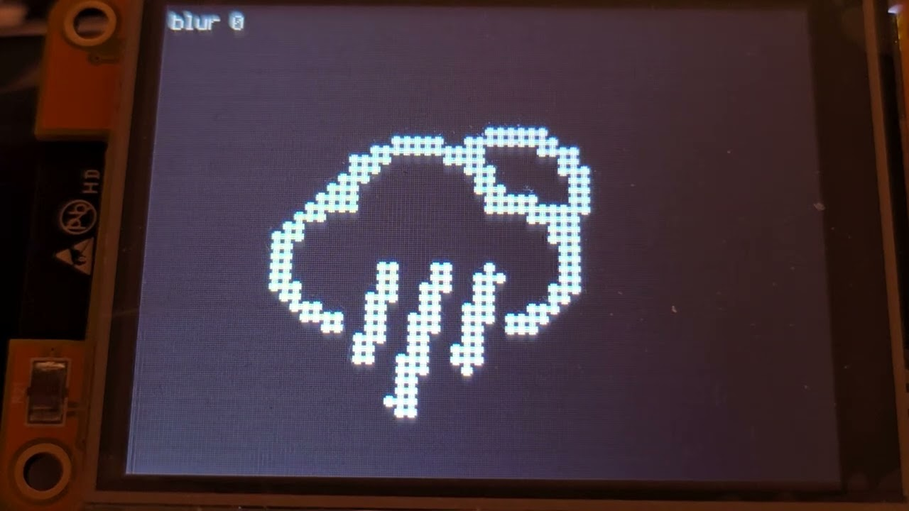](https://youtu.be/bh8ax5zkCpk)

Полёт рисуется двумя дисками: голова идёт по `t`, хвост сначала стоит и догоняет
её к концу. Яркость дисков складывается в 8-битную карту, между головой и
хвостом получается светлый мостик. Карта смешивается с предыдущим кадром, и за
точкой остаётся послесвечение, как на фосфоре. Этот способ подробно описан в
документации dgx: [Морфинг точечных
структур](https://github.com/jef-sure/esp32-component-dgx/blob/main/docs/morphing-ru.md).

## Значок погоды

С кодами погоды сервиса значки совпадают не полностью, соответствие составлено
вручную в `main/weather.c`.

Значок размером 24 пикселя разложен на точки, каждая точка на экране — 2
пикселя. При смене погоды точки одного значка за секунду перелетают на места
точек другого, как описано выше, а цвет за ту же секунду переходит к цвету
новой температуры. К готовому кадру применяется один проход размытия, о нём
в разделе «Графика»: без него видны ступеньки однобитной картинки.

# Графика

## Как было

В 2021 году я пытался придумать алгоритм автоматического определения числа
отрезков, но в итоге решил обойтись фиксированным: 13 на любую кривую. Мелкой
кривой столько — много, крупной — мало. Толщину делал в лоб: толстые отрезки,
а на стыках закрашенные круги, чтобы закрыть клинья. Стыками я, к сожалению,
так и не остался доволен, а когда замерил время, оказалось, что одни круги
занимают от трети до половины рисования символа. Недостатки стыков в основном
скрывало сглаживание, и ради него цифры рисовались на 8-битных виртуальных
экранах, где байт — количество чернил.

У каждой цифры был свой виртуальный экран, 40x120, и на дисплей уходили те,
что изменились. Рисовали на них две задачи, времени и погоды, а переносила на
дисплей третья, главная: ей слали сообщение, что кадр готов. Пока сообщение
шло, рисующая задача могла уже начать следующий кадр, и главная перенесла бы
на дисплей экран, стёртый наполовину. Чтобы этого не случалось, виртуальные
экраны охранял семафор: кто рисует или переносит, тот его держит.

## Как стало

Число отрезков считает редактор: для каждой кривой он хранит наименьшее, при
котором ломаная не отходит от кривой больше чем на пол-единицы. При выводе оно
умножается на корень из масштаба. Правой половине нуля из `font0ss` при
масштабе 1 нужно 13 отрезков, при половинном — 10, при двойном — 19. Интересно,
что при масштабе 1 выходят те самые 13, которые в 2021 году я подобрал на
глаз. Или просто глаз уже намётанный.

Корень потому, что отклонение ломаной от кривой уменьшается как квадрат числа
отрезков: вдвое большей кривой их нужно в 1,41 раза больше, а не вдвое.
Экономить на отрезках есть смысл: время рисования зависит от их числа, а не от
длины линии.

Отрезок теперь — одна выпуклая фигура: прямоугольник с плоским началом и диск в
толщину линии на конце. Начало закрыто диском предыдущего отрезка, так что
разрывов на изгибах нет при любом повороте. Шрифт рисуется примерно за 60%
прежнего времени.

Выигрыш не в пикселях, а в вызовах. Фигура закрашивается построчно: на каждую
строку экрана идёт вызов, который красит горизонтальную полоску от левого края
фигуры до правого. Вызов стоит 1,3–1,9 мкс почти независимо от того, сколько в
полоске пикселей. Раньше отрезок и круг на стыке красились отдельно, и там, где
они перекрывались, одна и та же строка экрана красилась дважды. Теперь фигура
одна и выпуклая: в любой строке экрана у неё ровно одна полоска, значит и вызов
один.

Сглаживания кривых больше нет: стыков, которые оно скрывало, нет по построению.
Постобработка осталась как возможность, но только у морфинга точек. Там каждый
кадр перед выводом можно пропустить через фильтр, и готовый фильтр размытия в
dgx есть: однобитный значок без размытия выглядит ступенчато. Значок погоды
им пользуется, один проход. Чего этот фильтр однажды стоил, рассказано в
разделе [«Память»](#память).

Восьмибитные виртуальные экраны остались, хотя сглаживания, ради которого они
были, уже нет. Байт — количество чернил: 0 — бумага, 255 — чернила. Цвета у
такого экрана нет, цвет появляется при переносе на дисплей: таблица из 256
значений говорит, каким цветом показать каждое количество чернил, от цвета
бумаги до цвета чернил. Чтобы перекрасить время, например на закате,
достаточно пересчитать таблицу, сам рисунок остаётся прежним. А восемь бит
вместо шестнадцати вдвое экономят память: полоса часов и минут 320x100
занимает 32 КБ вместо 64, полоса температуры 220x74 — 16 КБ, полоса названия
города 320x46 — ещё 15 КБ.

Виртуальный экран — это память, шина SPI в рисовании на нём не участвует. По SPI
идёт перенос нарисованного на дисплей, и не всего экрана, а только того
участка, который изменился. Какой участок изменился, экран знает сам: dgx при
каждом рисовании отмечает, где оно было. Перо за один шаг меняет несколько
пикселей вокруг своего кончика, они и уходят на дисплей. Кадр превращения
стирает и рисует заново только знакоместо меняющейся цифры, и на дисплей
уходит только оно.

Этого в dgx не было, перенос участка появился уже по ходу работы над часами.
Пока на дисплей уходила вся полоса, кадр занимал 17 мс при любом числе
меняющихся цифр, и тратить их на одну цифру было жалко.

Пока цифра превращается в следующую, картинка перерисовывается много раз подряд.
Когда меняется одна цифра часов или минут, перерисовка вместе с переносом на
дисплей занимает 4,4 мс вместо прежних 17, и за полсекунды превращения их
выходит около ста. Две соседние цифры — 8,7 мс, все четыре — 15 мс.
Строка секунд маленькая, её перерисовка занимает 0,2 мс.

С дисплеем работает ровно одна задача. Я считаю правильным принцип, по
которому с физической шиной работает кто-то один: никакие блокировки не
нужны, а что делать, передаётся сообщениями. Такую архитектуру я стараюсь
делать всегда, и поэтому же все
компоненты, которые я публикую в
[реестре Espressif](https://components.espressif.com/components?q=namespace:jef-sure),
не потокобезопасны: устройством владеет одна задача, и защищать его не от
кого. Время, погода, город и значки ожидания рисуют каждый на своих
виртуальных экранах и шлют этой задаче сообщение: что показать и где.
Отправив сообщение, задача ничего не ждёт и занимается своим дальше.

Блокировка всё же есть, но не на шине, а на виртуальном экране: у каждого
свой мьютекс. Задача берёт его только тогда, когда ей понадобился свой экран,
а он ещё переносится на дисплей: прямо перед тем, как на нём рисовать. До
этого момента она свободна, и это время достаётся другим задачам.

Подробности про кривые, толстые линии и шрифт — в документации dgx: [Рукописный
текст в
DGX](https://github.com/jef-sure/esp32-component-dgx/blob/main/docs/handwriting-ru.md).

# Цвет

Время днём серебряное, чтобы быть ярче, ночью медное, чтобы не так бросаться в
глаза при вечернем освещении. Переход начинается за полчаса до восхода или
заката и заканчивается через полчаса после. Восход и закат приходят в ответе о
погоде.

Название города днём светло-голубое, а ночью того же медного цвета, что и
время. Значки ожидания в верхней строке всегда того же цвета, что и время.

Погода ночью тоже приглушается, но иначе. Оттенок у неё значит температуру, и
менять его нельзя, поэтому меняется только яркость: к ночи она опускается до
60% дневной, все три составляющие цвета умножаются на одно число.

Цвет температуры и значка погоды считается по формуле из часов 2021 года: 23
градуса приняты за «комфортный» уровень, ниже цвет уходит в синий, выше — в
красный. После этого цвет выравнивается по яркости: самая сильная из трёх его
составляющих всегда равна 224 из 255. Без этого одни цвета выходили бы
тусклее других, и синее число в мороз читалось бы хуже красного в жару.

Цвет погоды тоже меняется плавно. Когда приходит другая температура, значок и
число за секунду переходят от старого цвета к новому, вместе с превращением
значка. Рисунок при этом не трогается: и время, и погода нарисованы количеством
чернил, а цвет — это таблица из 256 значений, которая пересчитывается на каждый
кадр перехода.

# Часы как устройство

## Железо

Плата CYD (ESP32-2432S028), она же Cheap Yellow Display: ESP32 и экран 2.8"
320x240 на контроллере ILI9341, тот же экран, что был в 2021 году. Плата очень
популярная и стоит недорого. Выбрана потому, что дисплей на ней уже припаян и не
надо каждый раз проверять провода. Удобно проводить разные эксперименты, имея
одно стандартное подключение дисплея.

В 2021 году я пробовал один большой дисплей и два поменьше рядом и выбрал самый
большой, какой был. ESP32 взят за WiFi и за память: виртуальным экранам нужно
несколько десятков килобайт RAM. Теперь к этому добавился BLE для настройки.

Раскладка сделана под этот дисплей: время сверху, под ним строка погоды, внизу
название города, и всё свободное место между ними распределено.

Размер цифр и толщина пера зависят друг от друга: перу нужно место по краям
знакоместа, а толщина считается от масштаба. Поэтому раскладка считается в два
прохода.

## Память

Оперативной памяти в часах немного, и расходится она так. Виртуальные экраны:
полоса часов и минут 32 КБ, полоса температуры 16 КБ, полоса названия города
15 КБ, строка секунд и значки ожидания вместе меньше 2 КБ. Свечение значка
погоды: две карты яркости по байту на пиксель, 80x74 пикселя, 12 КБ. Стеки
задач: пять по 4 КБ, у задачи погоды 8 КБ, у кнопки 2 КБ, всего 30 КБ.
Остальное забирают WiFi и система.

Самого требовательного потребителя в этом списке нет, потому что живёт он
секунду: это TLS-рукопожатие при запросе погоды. Сервис отдаёт цепочку из
четырёх сертификатов с ключами до 4096 бит, и на её проверку вместе с
буферами TLS уходит около 53 КБ под ESP-IDF 5.5 и около 48 КБ под 6.0. Эта
память должна находиться каждые 5 минут, иначе погода не придёт.

| | ESP-IDF 5.5.4 | ESP-IDF 6.0.1 |
| --- | --- | --- |
| Свободно перед запросом погоды | 71 КБ | 73 КБ |
| Остаётся в худший момент рукопожатия | 19 КБ | 26 КБ |

Замерено сразу после включения, когда на экране ещё стоят значки ожидания.
Дождавшись своего, они уходят вместе со своей задачей и возвращают ещё 7,5 КБ:
полосу, стек задачи и то, чем она пользовалась.

С этими значками вышла история уже по ходу работы над текстом. Под ESP-IDF 5.5
погода вдруг перестала приходить: рукопожатию не хватало одного килобайта на
проверку сертификата. Память заняли значки ожидания, которые я добавил
накануне. Они живут, пока не пришла первая погода, а погода не могла прийти,
пока они держат память. Сначала я выключил размытие значка погоды: его копия
кадра стоила 6 КБ. А потом в dgx 0.4.9 свечение стало занимать два байта на
пиксель вместо четырёх, размытие в один проход научилось обходиться без
копии, и оно вернулось. Перед запросом погоды стало свободно 71 КБ вместо 52.

Из той же экономии два решения, о которых сказано ниже, в «Настройке»: модуль
BLE выгружается, как только сеть задана, а страница настроек живёт в
отдельной загрузке и не делит память с экранами часов.

## Настройка

В часах 2021 года пароль от WiFi и ключи сервисов лежали в `sdkconfig`, то есть
в прошивке. Теперь в конфигурации проекта только железо, а всё, что относится к
месту, сети и сервисам, часы хранят у себя в NVS и переживают перепрошивку.
Задаётся это двумя способами: сеть WiFi — с телефона по BLE, стандартным
приложением от Espressif, которое есть в Google Play и в App Store, остальное
— на веб-странице, которую часы поднимают сами. Ни то, ни другое не требует
компьютера.

### Сеть

В часах с матричным шрифтом сеть задавалась через SoftAP: часы поднимали свою
точку доступа. От этого я отказался: на телефоне приходится вручную
подключаться к новой, посторонней точке доступа. По BLE телефон остаётся в
своей сети, а всё остальное делает приложение.

Приложение называется ESP BLE Provisioning. Часы, которые не знают сети,
показывают QR-код для него. В QR-коде имя устройства, `CLOCK-` и три последних
байта MAC-адреса, и пароль подтверждения: сеть сможет задать телефон, который
прочитал код с экрана, а не любой, кто услышал часы по BLE. Приложение присылает
имя сети и пароль, часы пробуют подключиться и отвечают телефону: подключились,
неверный пароль или такой сети нет. На отказ можно прислать другую сеть.

Когда сеть у часов уже есть, а её надо сменить, прежняя откладывается, пока
идёт настройка: если телефон за 3 минуты не пришёл, часы возвращаются к
прежней сети и к работе. Часы без сети ждут телефон сколько угодно.

BLE нужен только на это время. Настройка сети — отдельная загрузка: получив
сеть, часы перезапускаются, и в обычной работе модуль BLE выгружен, память
его контроллера возвращена в кучу. Заодно радио не приходится делить между
WiFi и BLE, и WiFi работает без режима сна: с ним часы отвечали на запрос
страницы с задержкой.

Имя в сети до настройки — `weather-clock-` и те же три байта MAC-адреса, чтобы
два экземпляра в одном доме не спорили за имя. Под этим же именем часы отвечают
как `<имя>.local`. Имя можно сменить на странице; в нём остаются буквы, цифры и
дефисы, остальное превращается в дефис.

Из нескольких точек доступа с одним именем сети часы выбирают самую сильную, а
не первую услышанную, и после разрыва подключаются снова через 2 секунды.

### Страница настроек

Кнопка BOOT перезапускает часы в режим настроек. Длительность нажатия ничего
не значит, долгого нажатия нет: в корпусе кнопка может быть сенсорной, а часы,
когда их переносят, держат в руке как придётся, и палец может лежать на ней
сколько угодно.

Режим настроек — отдельная загрузка. Нажатие записывает просьбу в NVS и
перезапускает часы; следующая загрузка забирает просьбу, стирает её и
поднимает не часы, а страницу, а загрузка после неё — снова часы. Так у
страницы экран и память целиком свои: веб-серверу не приходится делить RAM с
виртуальными экранами и задачами часов.

Поднявшись, часы подключаются к сети и показывают адрес страницы текстом и
QR-кодом, рядом уровень сигнала: страница, которая грузится плохо, объясняется
слабым сигналом. Страница ждёт 5 минут, потом часы возвращаются к работе.
Закрывает её и повторное нажатие кнопки. Если к сети за минуту подключиться не
удалось, следующая загрузка предлагает задать другую сеть по BLE, и если никто
не пришёл, часы идут работать с прежней.

На странице: ключ OpenWeatherMap, место, название на экране, часовой пояс, имя
в сети и две галки. «Забыть сеть WiFi» нужна, когда сеть сменилась: другой
роутер, другой пароль, часы переехали. Часы забывают сеть и снова показывают
QR-код для настройки с телефона. «Забыть всё» нужна, когда часы отдают другому
человеку, например в подарок: стираются и сеть, и ключи сервисов, и место с его
названием. Сохранённые настройки вступают в силу перезапуском.

Оформление страницы — Bootstrap, своего кода на JavaScript в ней три
функции: спрятать поля, которые не нужны при выбранном способе определения
места, и переспросить перед «Забыть всё».

#### Как страница сделана

Веб-страница на микроконтроллере обычно либо целиком статическая, либо
собирается в коде из обрывков HTML в `printf`, и тогда её нельзя ни открыть в
браузере, ни отдать верстальщику. Здесь страница — обычный HTML-файл,
`misc/index.html`. Его можно открыть с диска и смотреть, как он выглядит,
править в любом редакторе; значения полей в нём обозначены местами вроде
`%HOST_NAME%` и `%TIMEZONE_OPTIONS%`.

Придумал я это ещё для
[часов с матричным шрифтом](https://habr.com/ru/articles/817927/), вместе с
QR-кодом для настройки. Там HTML нарезал скрипт на Perl. На Python пришлось
перейти потому, что его ESP-IDF тащит за собой в любом случае, а Perl у
человека может не оказаться.

При сборке скрипт `misc/split_to_template.py` этот файл сжимает, убирая
комментарии и пробелы между тегами, и нарезает по этим местам на куски. Из
кусков получается заголовочный файл с массивом пар «постоянный текст,
обработчик»: постоянный текст — кусок HTML до очередного места, обработчик —
функция, которая выводит значение этого места. Имя функции делается из имени
места: `%HOST_NAME%` становится `http_data_host_name`. У страницы часов восемь
мест и девять кусков, 4 КБ HTML после сжатия.

Массив включается в `main/webserver.c`, где эти функции написаны. Проверяет
соответствие компилятор: место, добавленное в HTML без функции, или функция без
места — это ошибка сборки, а не пустое поле на странице, замеченное через
полгода.

Запрос страницы обрабатывается проходом по массиву: отдать постоянный кусок,
вызвать обработчик, следующий кусок. Отдаётся всё по частям, chunked, прямо из
flash: страница в памяти не собирается, буфера под неё нет, шаблонизатора
нет. Обработчик отправляет значение, заменяя `&`, `<`, `>` и кавычки на
сущности HTML, чтобы ключ или название с таким знаком не ломали страницу.
Единственный обработчик с буфером — список часовых поясов: это около 600
строк `<option>`, десятки килобайт, они копятся по килобайту и уходят пачками,
а не по одной.

Ответ формы приходит `POST` в кодировке формы, не больше 2 КБ, и разбирается на
месте в полученной строке: `%XX` и `+` раскрываются туда же, откуда прочитаны,
памяти под копию не нужно. Поля ложатся в структуру настроек, и она целиком
сравнивается с текущей: если ничего не изменилось, в NVS ничего не пишется, а
страница отвечает «без изменений». После разбора браузер перенаправляется на
страницу результата, поэтому обновление страницы в браузере форму не
отправляет повторно.

Настройки хранятся в NVS одной записью: структура и номер её версии. Когда
поле добавляется, номер растёт, а запись прежней версии читается как начало
новой, и новые поля получают значения по умолчанию. Так прошивка обновляется
без потери настроек. Запись незнакомой версии не читается вовсе, и часы
начинают с чистого листа.

### "С КАКОВА ТЫ ГОРАДА"

Место задаётся одним текстовым полем, и понимается оно трояко: координаты
(«52.52,13.40»), город со страной («Berlin,DE») или почтовый индекс со страной
(«10115,DE»). Координаты берутся как есть, остальное один раз спрашивается у
геокодера OpenWeatherMap: сначала как название, потом, если не нашлось и текст
начинается с цифр, как индекс. Найденные координаты и название сохраняются и
больше не спрашиваются, пока текст в поле не изменится.

Города с одним названием встречаются: Франкфуртов в Германии два, на Майне и на
Одере, и по названию сервис выберет один из них сам. Индекс или координаты
надёжнее.

Название на экране можно задать своё. Сервис называет место по-своему: полным
именем города там, где хватило бы короткого, или городом там, где привычнее
название района. Пустое поле — название от сервиса, оно в этом поле показано
серым как подсказка. У места, заданного координатами, названия нет, оно берётся
из ответа о погоде и тоже сохраняется.

Название города приходит от сервиса как есть, а в шрифте только латиница,
немецкие «ä», «ö», «ü», «ß» и русский алфавит. Буква другого языка, с
чёрточкой, галочкой или хвостиком, пишется без своего знака: «Kraków» как
«Krakow», «Málaga» как «Malaga», «Łódź» как «Lodz». Немецкие названия не
меняются: «Köln» остаётся «Köln».

Замена идёт по таблице в `main/city_face.c`. Она составлена вручную и
покрывает два блока Юникода, Latin-1 Supplement и Latin Extended-A, знаки от
U+00C0 до U+017F, всего 192. Каждой букве в ней сопоставлена она же без
знака, а буквам вроде «æ», «œ» и «þ» — две: «ae», «oe», «th». Этого хватает
на европейские языки с латиницей. Знак, которого нет ни в шрифте, ни в
таблице, пропускается.

Определение места по IP-адресу через [ipinfo.io](https://ipinfo.io)
осталось от часов 2021 года, для него нужен свой ключ. Тогда город определялся
только так, и у меня он регулярно оказывался соседним: ошибка в десятки
километров для этого способа обычное дело. Для погоды и часового пояса это не
так уж важно, но на экране приятнее читать правду. Поэтому теперь он
выключен, пока его не включат. Включённый, он переспрашивает место каждые 10
минут: часы с таким способом могут переезжать.

### Время

Время приходит с pool.ntp.org, как только есть адрес в сети. До этого часы
идут от времени сборки прошивки, и на экране неправда.

Часовой пояс либо выбирается из списка, либо находится сам. Список делается при
сборке из базы tz той машины, на которой идёт сборка: для каждой зоны скрипт
`misc/generate_tzones.py` берёт из её файла строку правил в формате POSIX,
например `CET-1CEST,M3.5.0,M10.5.0/3` для Берлина, а из таблицы `zone.tab` —
страну и координаты главного города зоны. В октябре 2026 года зон вышло 598.
Самой базы на микроконтроллере нет, только эта таблица, и переход на летнее
время библиотека считает по строке правил.

Когда пояс не выбран, его приходится вычислять. Названия пояса в ответе о
погоде нет: там только страна места и его смещение от UTC в секундах на этот
момент, например 7200. Одного смещения мало: по нему не узнать, переводятся
ли здесь стрелки и когда. Поэтому из зон этой страны берутся те, у которых
смещение сейчас такое же, из них — ближайшая к месту по координатам, а если у
нескольких зон правила совпадают, то главная зона страны. Найденный пояс
сохраняется, и дальше часы живут по его правилам, с летним временем. Пока
погода не пришла, часы показывают UTC. Если подходящей зоны в таблице не
нашлось, берётся просто смещение без летнего времени.

Готовое название пояса, вроде `Europe/Berlin`, приходит только при
определении места по IP-адресу: его отдаёт ipinfo.io, и тогда
вычислять нечего.

### "КАК ДИЛА"

Погода спрашивается у [openweathermap.org](https://openweathermap.org/), API
2.5, текущая погода по координатам, каждые 5 минут. После неудачи — через 30
секунд, потом интервал удваивается до тех же 5 минут. Ключ бесплатный; без него
часы показывают только время. Из ответа, кроме погоды и температуры, берутся
восход и закат для смены цвета, название места и подсказка часового пояса.

Вход в настройки на видео: кнопка, перезапуск, подключение к сети, адрес
страницы.

[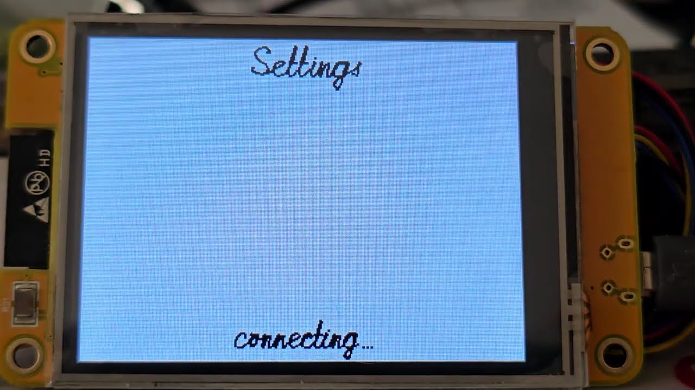](https://youtu.be/48G7s-aJNIw)

Подключившись, часы показывают адрес страницы QR-кодом и текстом:

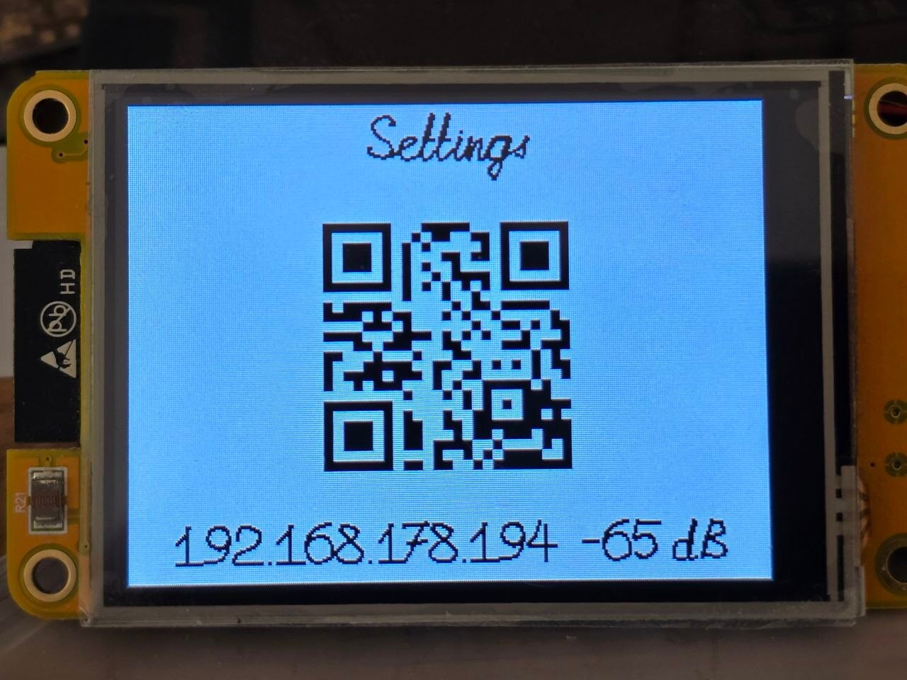

Сама страница:

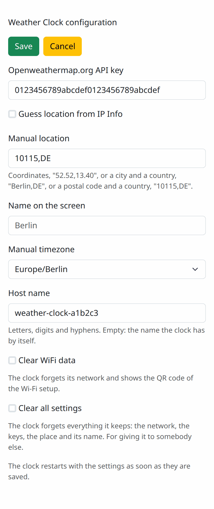

## Включение

После включения часы пишут время и сохранённое название города. Чего они ещё
ждут, показывают три значка в верхней строке слева, напротив секунд, каждый на
своём месте. Знак WiFi, пока идёт подключение: дуги появляются одна за другой.
Потом буква «Z», пока время спрашивается у сети, и «W», пока спрашивается
погода. Дождавшись своего в первый раз, значок уходит. Когда ушли все три,
строка пуста: всё работает как задумано.

## Сборка

Нужен ESP-IDF 5.2 или новее: нижнюю границу задаёт dgx, у самих часов своих
требований к версии нет. Число 5.2 диктуется шиной I2C: она написана на
драйвере, которого в более ранних версиях нет. Остальной API, которым я
пользуюсь, с этой версией совместим, но моя локальная версия выше: собирал и
проверял я под 5.5.4 и 6.0.1, на одной плате, а реальную работу под версиями
от 5.2 до 5.4 не проверял. Компоненты, включая dgx 0.4.9, скачает менеджер
компонентов.

Версии названы на момент публикации, октябрь 2026 года. dgx 0.4.9 тогда был
последним, а 5.5.4 и 6.0.1 — те версии ESP-IDF, что были под рукой.

    idf.py set-target esp32
    idf.py build
    idf.py -p /dev/ttyUSB0 flash monitor

Ключ для погоды бесплатный, выдаётся на
[openweathermap.org](https://openweathermap.org/). Без него часы показывают
только время.

### Подключение дисплея

На плате CYD всё уже соединено. Для другой платы выводы задаются в
`main/display.c`:

| Дисплей | Вывод |
|---------|-------|
| MOSI    | 13    |
| MISO    | 12    |
| CLK     | 14    |
| CS      | 15    |
| DC      | 2     |
| BLK     | 21    |

Кнопка — GPIO 0.

## Компромиссы

  1. Прогноза нет, только погода сейчас. У OpenWeatherMap он есть и
     бесплатный, на 5 дней с шагом 3 часа, но это другой запрос и другой
     разбор, в часах его нет;
  2. Зона по ближайшему месту иногда ошибается там, где рядом зона без летнего
     времени: Эль-Пасо получит зону Финикса. Тогда пояс надо выбрать на
     странице;
  3. Буквы других языков с диакритикой в названии города пишутся без неё, об
     этом в разделе про место. Иероглифов и арабского письма в шрифте нет:
     такое название будет написано частично или не будет написано;
  4. Страница настроек берёт оформление из интернета. Без интернета на телефоне
     она работает, но выглядит как голый HTML;
  5. Страница без пароля. Она существует только после нажатия кнопки и только в
     локальной сети.

## Использованные сторонние ресурсы

  1. Значки погоды — шрифт [Weather Icons](https://github.com/erikflowers/weather-icons)
     Эрика Флауэрса, лицензия SIL OFL 1.1. Сам шрифт лежит в `misc`, в
     `main/fonts` — его часть, переведённая в код утилитой `font2c` из dgx;
  2. Разбор JSON — [mjson](https://github.com/cesanta/mjson), Cesanta, MIT.
     Появился он в [часах с матричным шрифтом](https://habr.com/ru/articles/817927/):
     там cJSON из состава ESP-IDF на ответе с прогнозом погоды в 16 КБ мог
     запросить больше памяти, чем было свободно в куче. mjson дерева из ответа
     не строит и память не выделяет: значение читается по пути вроде
     `$.main.temp` прямо из текста. Здесь прогноза нет и ответ в 600 байт, но
     библиотека осталась. Тогда она не была портирована на ESP32, теперь это
     компонент [jef-sure/mjson](https://components.espressif.com/components/jef-sure/mjson/).

# Вместо итога

Полезной вещью для дома эти часы станут, когда у них появится корпус, а это
уже за пределами статьи. Пока это плата на столе и переработка проекта 2021
года. Но в большей степени это демонстрация возможностей
[dgx](https://github.com/jef-sure/esp32-component-dgx): всё заметное на экране
делает она.

dgx — моя графическая библиотека для дисплеев на микроконтроллерах. Сейчас она
оформлена как компонент для ESP-IDF и лежит в его реестре компонентов. Писать её
я начал давно и под свой вкус: шина, экран и рисование разделены, скрытого
общего состояния нет, одинаковых экранов может быть несколько сразу. Рисование
не знает, куда рисует: настоящий дисплей и виртуальный экран в памяти для него
одно и то же.

Что из неё здесь видно:

  1. Рукописный шрифт: буквы как путь пера из кривых Безье, в любом размере и
     любой толщины, слитно;
  2. Письмо в темпе пера: время при включении, название города, температура,
     буквы «Z» и «W» в верхней строке;
  3. Морфинг рукописных символов: цифры времени;
  4. Морфинг точечных структур со свечением: значок погоды;
  5. Виртуальные экраны в 8 бит с таблицей цветов: всё, что меняет цвет, не
     перерисовываясь;
  6. Перенос на дисплей только изменившегося участка. Этого в dgx не было, оно
     появилось в версии 0.4.7 по ходу работы над часами;
  7. Утилита `font2c`: значки погоды из шрифта TTF и сам рукописный шрифт из
     редактора превращены ею в код.

Чего здесь не видно, а в dgx есть: драйверы ST7735, ST7789, GC9A01, SSD1351,
SSD1306, ST7565R и ST7920 кроме ILI9341, шины I2C и параллельная 8-битная кроме
SPI, монохромные экраны, составной экран из двух дисплеев, обычные растровые
шрифты с выводом UTF-8 текста в восьми ориентациях, текстурированные
четырёхугольники и дуговая шкала.

Часть этого можно посмотреть, не читая код: в репозитории dgx лежат готовые
[примеры](https://github.com/jef-sure/esp32-component-dgx/tree/main/examples).
Почти все собраны под ту же плату CYD, что и часы, и прошиваются на неё как
есть:

  1. `screen_demo` — общая проверка дисплея: заливки, текст, линии,
     прямоугольники, круги и треугольники по очереди. Единственный пример под
     обычный ESP32 с ILI9341 на проводах;
  2. `hw_font_demo` — рукописный шрифт: три строки подгоняются под экран и
     пишутся пером, слитно, по-русски и по-английски;
  3. `hw_morph_demo` — морфинг рукописных слов: слово превращается в следующее
     то целиком, то буква за буквой;
  4. `morph_demo` — морфинг точечных слов со свечением, буква за буквой;
  5. `glyph_morph_demo` — один большой символ на весь экран превращается в
     следующий: цифры, латиница, кириллица;
  6. `life_morph_demo` — «Жизнь» Конвея, где поколение не сменяет предыдущее, а
     перетекает в него;
  7. `flip_clock_demo` — перекидные часы: половинка цифры падает как створка,
     нарисованная текстурированным четырёхугольником;
  8. `texture_demo` — карточка с надписью нарисована один раз в текстуру, а
     потом масштабируется, вращается и колышется.

Демосцена в dgx:

[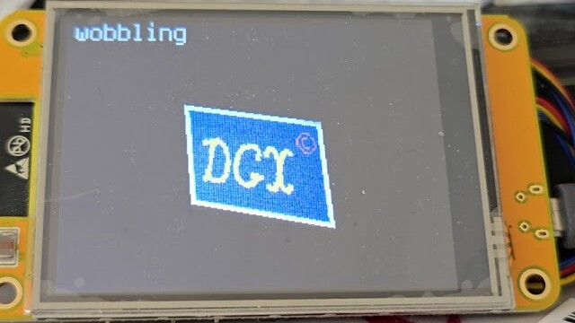](https://youtu.be/kyFe8z6md9k)
