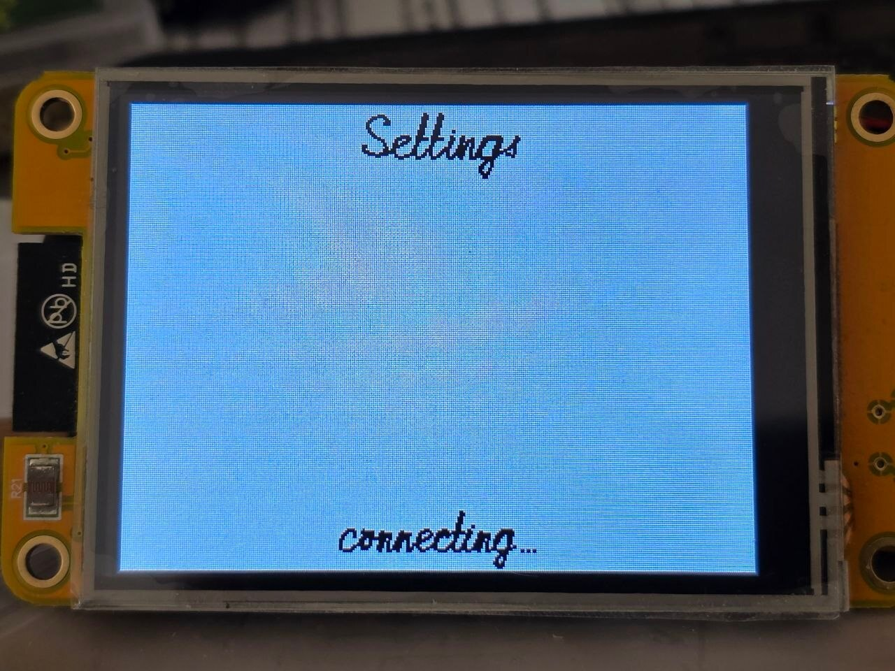

Часы с погодой на рукописном шрифте
===================================

Часы на ESP32 с экраном 320x240. Время, температура и название города написаны
рукописным шрифтом на кривых Безье: цифры времени перетекают одна в другую,
температуру и город пишет перо. Значок погоды собран из точек и тоже перетекает
из одного в другой.

Это вторая версия часов 2021 года. Первая описана в статье
[Шрифт на кривых Безье на микроконтроллере](https://habr.com/ru/articles/818873/)
и осталась в теге `2021`. От неё здесь идея и раскладка экрана, код написан
заново.

# Идея

Идею подсмотрел в канале о программировании ESP32: человек показал часы на шести
дисплеях, по цифре на каждом, и назвал источник — проект Bézier Clock на
Javascript разработчика Jack Frigaard. В 2021 году я сделал свои: каждая цифра
из трёх кубических кривых Безье, опорные точки подобраны в голове и в текстовом
редакторе на поле 100х160.

Про исходный проект на Хабре есть статья [Часы на кривых Безье](https://habr.com/ru/articles/236455/).
Как именно там сделано, я не смотрел: сразу решил делать по-своему и сначала
проверил, как превращение выглядит на дисплее. [Код того эксперимента](https://github.com/jef-sure/digits_morping_dgx)
сохранился, видео тоже:

Часы 2021 года на видео:

После тех часов остались три вопроса. Пароль от WiFi и ключи сервисов задавались
в `sdkconfig`. Город определялся по адресу в интернете и мог оказаться соседним.
Шрифт состоял из десяти цифр, а рисовать остальное без инструмента слишком
трудоёмко. Для шрифта я написал [редактор](https://github.com/jef-sure/hw-fonts),
нарисовал в нём латинский шрифт, и на этом тема подвисла на несколько лет.

Остановился я на стыках букв. Рукописный текст пишется слитно, и переход от
одной буквы к другой должен быть гладкой кривой, которая подстраивается под
соседа. Если просто приставить хвост одной буквы к началу другой, в месте
стыка получается излом или лишняя петля, а точек выходит больше, чем нужно
кривой. Решения тогда не нашлось.

В 2026 году шрифт дорисован до русского алфавита, в графической библиотеке
[dgx](https://github.com/jef-sure/esp32-component-dgx) появилась поддержка таких
шрифтов, а этим часам досталась роль первого проекта на них.

Рукописный текст в dgx на видео, ещё без часов:

# Теория

Кубическая кривая Безье описывает плавную линию с двумя изгибами между крайними
точками. Задаётся четырьмя точками: две крайние и две, к которым кривая тянется.
В рукописном шрифте есть и квадратичные кривые, по трём точкам: две крайние и
одна, к которой кривая тянется, изгиб у такой кривой один. Где хватает одного
изгиба, она проще в рисовании и в редакторе.
Подробно — в [Википедии](https://ru.wikipedia.org/wiki/%D0%9A%D1%80%D0%B8%D0%B2%D0%B0%D1%8F_%D0%91%D0%B5%D0%B7%D1%8C%D0%B5).

# Шрифт

Шрифт `font0ss` нарисован мной в редакторе и входит в dgx. В нём латиница с
немецкими буквами, русский алфавит, цифры и знаки.

Символ — это штрихи в том порядке, в каком их ведёт рука. Штрих бывает точкой,
прямой, квадратичной или кубической кривой. У букв есть связи: при слитном
письме конец одной буквы и начало следующей соединяются одной кривой. Точки над
«ё» и перекладина «t» ставятся, когда перо отрывается от бумаги, то есть после
слова. Цифры пишутся отдельно, связей у них нет.

Порядок штрихов здесь не формальность. Шрифт задуман так, чтобы текст можно
было писать, как пишет рука: буква за буквой, штрих за штрихом. Поэтому точка
над «i» не может быть частью буквы: рука ставит её, когда слово дописано.

Связь у буквы нарисована руками в редакторе, отдельно на вход и на выход. Стык
двух букв из них строится так. В идеале конец одной связи и начало другой
соединила бы кривая из пяти точек. В шрифте кривые только кубические, поэтому
берётся ближайшая к ней кривая из четырёх. Её концы стоят на концах связей, а
две средние точки лежат на тех прямых, по которым связи нарисованы: перо уходит
из одной буквы и приходит в другую в заданных направлениях. Связь, которой не с
чем соединиться, не пишется, слово не начинается и не кончается висящим
хвостиком.

Координаты в шрифте заданы в своих единицах: это шаг сетки, по которой буквы
нарисованы в редакторе. Для вывода они умножаются на масштаб, свой по каждой
оси. Цифры времени этим пользуются: самая широкая цифра занимает свою ячейку по
ширине, самая высокая — всю высоту строки, пропорции шрифта при этом не
сохраняются. Толщина пера считается от среднего из двух масштабов. На
экране 320x240 выходит 6 пикселей у часов и минут и 1 пиксель у секунд.

Цифры разной ширины. Каждая стоит в середине своей ячейки, поэтому время не
ездит по экрану, когда единица сменяет ноль.

Свой масштаб по каждой оси для рукописных букв был бы заметен: наклон и
округлости поплыли бы. Цифры в `font0ss` прямые и ровные, для рукописных даже
слишком. Зато хорошо читаются издалека, и растянуть их по высоте можно без
вреда.

# Графика

Кривая рисуется отрезками прямых. В 2021 году я пытался придумать, как
определять их число автоматически, и остановился на фиксированных 13. Теперь
число считает редактор: для каждой кривой он хранит наименьшее, при котором
ломаная не отходит от кривой больше чем на пол-единицы. При выводе оно
умножается на корень из масштаба. Правой половине нуля в половину величины
нужно 10 отрезков, вдвое крупнее — 19.

Корень потому, что отклонение ломаной от кривой падает как квадрат числа
отрезков: вдвое большей кривой их нужно в 1,41 раза больше, а не вдвое. Экономить
на отрезках есть смысл: время рисования идёт за их числом, а не за длиной линии.

Толстая кривая в 2021 году состояла из толстых отрезков и закрашенных кругов на
стыках. Стыками я тогда остался недоволен. По замерам одни круги занимали от
трети до половины времени рисования символа. Теперь отрезок — одна выпуклая
фигура: прямоугольник с плоским началом и диск в толщину линии на конце. Начало
закрыто диском предыдущего отрезка, так что разрывов на изгибах нет при любом
повороте. Шрифт рисуется примерно за 60% прежнего времени.

Выигрыш не в пикселях, а в вызовах. Фигура закрашивается построчно: на каждую
строку экрана идёт вызов, который красит горизонтальную полоску от левого края
фигуры до правого. Вызов стоит 1,3–1,9 мкс почти независимо от того, сколько в
полоске пикселей. Раньше отрезок и круг на стыке красились отдельно, и там, где
они перекрывались, одна и та же строка экрана красилась дважды. Теперь фигура
одна и выпуклая: в любой строке экрана у неё ровно одна полоска, значит и вызов
один.

Сглаживания больше нет. В старых часах оно в основном скрывало недостатки
стыков, но теперь их нет по построению.

Цифры времени рисуются не сразу на дисплее, а на 8-битном виртуальном экране,
где байт — количество чернил: 0 — бумага, 255 — чернила. Цвета у него нет. Цвет
появляется при переносе на дисплей: таблица из 256 значений говорит, каким
цветом показать каждое количество чернил, от цвета бумаги до цвета чернил.

Чтобы перекрасить время, например на закате, достаточно пересчитать таблицу.
Сам рисунок остаётся прежним.

Восемь бит на пиксель вместо шестнадцати достались от часов 2021 года: там
промежуточные значения были нужны сглаживанию. Сглаживания больше нет, а восемь
бит остались, потому что вдвое экономят память. Полоса часов и минут 320x100
занимает 32 КБ вместо 64, полоса температуры 220x74 — 16 КБ, полоса названия
города 320x46 — ещё 15 КБ.

Пока цифра превращается в следующую, картинка перерисовывается много раз
подряд. Когда меняется одна цифра часов или минут, перерисовка вместе с
переносом на дисплей занимает 4,4 мс, за полсекунды их выходит около ста. Две
соседние цифры — 8,7 мс, все четыре — 15 мс. Строка секунд маленькая, её
перерисовка занимает 0,2 мс.

Виртуальный экран — это память, шина SPI в рисовании на нём не участвует. По SPI
идёт перенос нарисованного на дисплей, и не всего экрана, а только того
участка, который изменился. Какой участок изменился, экран знает сам: dgx при
каждом рисовании отмечает, где оно было. Перо за один шаг меняет несколько
пикселей вокруг своего кончика, они и уходят на дисплей. Пока переносилась вся
полоса, кадр часов и минут занимал 17 мс при любом числе меняющихся цифр.

С дисплеем работает ровно одна задача, поэтому ни мьютекс, ни семафор на шине
не нужен. Время, погода и город рисуют каждый на своих виртуальных экранах и
шлют этой задаче сообщение: что показать и где. Послав, задача ничего не ждёт и
занимается своим дальше.

Задача блокируется только тогда, когда ей понадобился свой экран, а он ещё
переносится на дисплей: прямо перед тем, как на нём рисовать. До этого момента
она свободна, и это время достаётся другим задачам. Блокировка — мьютекс, у
каждого виртуального экрана свой. В 2021 году на его месте был семафор.

Подробности про кривые, толстые линии и шрифт — в документации dgx:
[Рукописный текст в DGX](https://github.com/jef-sure/esp32-component-dgx/blob/main/docs/handwriting-ru.md).

# Морфинг

Превращение одной цифры в другую устроено так же, как в 2021 году. Опорные точки
кривой идут по прямой со старого места на новое: `P(t) = Pa + t*(Pb - Pa)`. По
новым точкам строится кривая и рисуется как любая другая.

Для этого кривые у обеих цифр должны быть одного вида, а в шрифте штрихи
разные: точки, прямые, квадратичные и кубические кривые. Поэтому перед
превращением все они приводятся к кубическим. Прямая и квадратичная кривая
повышаются до кубической без изменения формы, точка становится кривой, у
которой все четыре точки в одном месте. После этого цифра — список кубических
кривых, а превращение — список пар таких кривых.

## Пары кривых

В 2021 году у каждой цифры было ровно три кривые, и соответствующие пары шли по
порядку. В шрифте цифра нарисована так, как её пишет рука, и порядок письма для
пар не годится: у девятки сначала овал и в конце хвост, у семёрки сначала верх,
и верх одной летел бы вниз, чтобы стать хвостом другой. Поэтому пары выбираются
перебором так, чтобы все точки вместе прошли наименьший путь. Кривую при этом
можно взять с другого конца, рисует она то же самое. У цифр `font0ss` путь
выходит в среднем на 30% короче, чем по порядку письма, а при переходе двойки в
девятку — вчетверо.

Штрихов у цифр разное число. Штрих, которому не досталось пары, вырастает из
точки или уходит в неё.

## Место

Сдвиг цифры до середины ячейки зависит от её ширины, поэтому у старой и новой
цифры он разный. Он меняется вместе с `t`: единица, превращаясь в ноль, заодно
переезжает на его место.

## Время

Превращение длится полсекунды и заканчивается ровно к наступлению секунды,
которая показана на экране. Вторые полсекунды картинка стоит: глазу нужно
время, чтобы её прочитать.

Параметр `t` в формуле — это доля пройденного пути: при 0 на экране старая
цифра, при 1 новая, между ними промежуточная форма. Считается он из времени:
сколько прошло с начала превращения, делённое на его длительность. Четверть
секунды после начала — это `t = 0.5`, сколько бы кадров к этому моменту ни
было нарисовано. Если кадр рисовался дольше обычного, следующий просто
окажется чуть дальше по пути, а закончится превращение вовремя.

В кривые идёт не сама эта доля, а сглаженная известной формулой smoothstep:
`t*t*(3 - 2*t)`. В начале и в конце она меняется медленнее, чем в середине, и
цифра трогается и останавливается плавно.

## Кадр

Кадр превращения каждый раз новая картинка, прежнюю надо убрать. Поэтому цифры
рисуются на виртуальном экране и уходят на дисплей готовыми, без мерцания.
Кадров столько, сколько успевает: около ста за полсекунды, когда меняется одна
цифра часов или минут.

Стирается и рисуется заново только ячейка той цифры, которая меняется. Цифра по
дороге к следующей из своей ячейки не выходит: проверено на плате для всех 90
пар цифр, в обоих размерах. Остальные цифры и двоеточие остаются как были
нарисованы, и на дисплей уходит только эта ячейка.

Строк две: часы с минутами и секунды. Большая перерисовывается раз в минуту,
маленькая — каждую секунду.

Секунды мелкие, в шестую часть высоты часов и минут, в углу над минутами.
Крупные секунды всё время движутся, и глаз за них цепляется: посмотрел на часы
и залип. Убирать их совсем не хотелось, иногда секунды нужны. В таком размере
их видно, если искать, и они не отвлекают.

## Матричный морфинг

Значок погоды превращается иначе. Он не из кривых, а из точек, и пар у точек
нет: в одном значке их больше, в другом меньше. Новая точка прилетает от
ближайшей точки старого значка, которая ещё никому не служит источником.
Ближайшая ищется не точка за точкой, а вектор за вектором, сразу для всей
сетки. Линия, сдвинувшаяся вбок, находит свою старую линию одним вектором и
едет целиком, а не рассыпается. Точка, которой некуда лететь, гаснет на месте.

Это пригодилось из-за самого шрифта. Значки в Weather Icons, к сожалению, не
выровнены между собой: одно и то же облако в соседних значках стоит на разных
местах и бывает разного размера. Поэтому переход от значка к значку часто
выглядит как сдвиг или как изменение размера. Благодаря поиску по векторам
части значка при этом едут целиком, и переходы не выглядят нервными. Бывает и
красиво: солнце за облаком при смене погоды «отращивает» лучи, и переход
смотрится органично.

Полёт рисуется двумя дисками: голова идёт по `t`, хвост сначала стоит и
догоняет её к концу. Яркость дисков складывается в 8-битную карту, между
головой и хвостом получается светлый мостик. Этот способ подробно описан в
документации dgx:
[Морфинг точечных структур](https://github.com/jef-sure/esp32-component-dgx/blob/main/docs/morphing-ru.md).

# Перо

Письмо отличается от морфинга тем, что кадр не надо стирать: перо только
добавляет чернила. Текст рисуется не весь, а до того места, куда дошло перо, и
это место со временем уходит вперёд.

Вопрос в том, чем это место мерить. Если длиной пройденного пути, перо идёт с
ровной скоростью, а рука так не пишет: на прямой она быстрая, на завитке
медленная. Поэтому мера другая, трудоёмкость. У каждого штриха она своя:

    трудоёмкость = длина + k × число отрезков

Длина — это путь пера по штриху. Число отрезков — мера изогнутости: чем круче
кривая, тем больше прямых отрезков нужно, чтобы её нарисовать. Коэффициент `k`
говорит, во сколько единиц пути обходится каждый отрезок. При `k = 0` перо идёт
ровно, в часах `k = 6`.

Пример из `font0ss`. У единицы путь 271, отрезков 5. У буквы «о» путь короче,
208, зато отрезков 23. При ровной скорости единица писалась бы дольше. При
`k = 6` трудоёмкость единицы 301, а «о» — 346, и круглая буква пишется дольше
трёх почти прямых штрихов, как у руки.

У точки длины нет, а время на неё уходит. Ей и каждому переносу пера по воздуху
назначена наименьшая трудоёмкость, такая же, как у дефиса: 44.

Перо тратит трудоёмкость с постоянным темпом. Цифры часов и минут пишутся с
темпом 3000 единиц в секунду, город и температура — 1500. Время, прошедшее с
начала письма, умноженное на темп, говорит, сколько перо уже потратило, а
значит, где оно сейчас. Это тот же приём, что `t` у превращения цифр.

Длину и число отрезков микроконтроллер не считает. Штрих не меняется, поэтому
оба числа один раз считает редактор шрифтов, когда сохраняет шрифт, и
записывает рядом со штрихом. Микроконтроллеру остаётся прочитать их и сложить.

От потраченной трудоёмкости до пикселя три шага. Сначала находится штрих, на
который она приходится: все штрихи до него закончены. Потом место на этом
штрихе, и считается оно по пути вдоль ломаной, а не по параметру кривой.
Отрезки различаются по длине во много раз: прямой штрих — один длинный,
завиток — много коротких, и перо, которое вели бы отрезок за отрезком, то
ползло бы, то прыгало. Наконец, отрезок под пером рисуется до того места, куда
оно дошло, с круглым кончиком.

Каждый раз рисуется только новое. Текст, дописанный за любое число шагов,
пиксель в пиксель совпадает с текстом, нарисованным сразу.

Время письма от масштаба не зависит. Трудоёмкость считается в единицах шрифта,
а не в пикселях, поэтому крупный текст пишется столько же, сколько мелкий:
перо на экране просто идёт быстрее. Зависит оно только от самого текста и от
темпа. «Frankfurt am Main» при темпе 1500 единиц в секунду перо пишет 5,2
секунды, при темпе 3000 писало бы 2,6.

Пером пишется:

  1. Время при включении, цифра за цифрой, примерно за секунду. Дальше цифры
     только перетекают;
  2. Название города, буква за буквой;
  3. Температура. Меняется она редко, поэтому морфинг ей не нужен. Знаки,
     которые изменились, перо сначала стирает тем же путём, каким писало, вдвое
     быстрее, потом пишет новые. Знак градуса стоит у правого края, цифры и
     минус перед ним — на постоянных местах.

Стирает перо так же, как пишет: тем же путём и той же толщины, только чернилами
цвета бумаги. Отдельного кода для стирания нет.

Знака «℃» в шрифте нет. Он собран на месте: кольцо в левом верхнем углу и узкая
буква «C» из шрифта, вместе в размер одной цифры.

Минус перед числом — не дефис. Дефис в шрифте стоит посередине строчных букв,
там ему и место в названии вроде «Ростов-на-Дону». Перед цифрами он оказывается
слишком низко и выглядит как подчёркивание, сползшее вверх. Поэтому в `font0ss`
есть отдельный знак минуса: черта на середине высоты цифр, на 31 единицу выше
дефиса. Шрифт сам одно на другое не заменяет, минус ставит код, который пишет
число: в температуре стоит «−», а в названии города остаётся «-».

Включение на видео: перо пишет время, температуру и название города.

# Цвет

Время днём серебряное, ночью медное. Переход начинается за полчаса до восхода
или заката и заканчивается через полчаса после. Восход и закат приходят в
ответе о погоде.

Название города идёт за временем: днём оно светло-голубое, ночью такое же
медное, и переходит из одного цвета в другой в тот же час. Иначе ночью рядом с
приглушённым временем оставалась бы яркая строка.

Погода ночью тоже приглушается, но иначе. Оттенок у неё значит температуру, и
менять его нельзя, поэтому меняется только яркость: к ночи она опускается до
60% дневной, все три составляющие цвета умножаются на одно число.

Цвет температуры и значка погоды считается по формуле из часов 2021 года: 23
градуса приняты за «комфортный» уровень, ниже цвет уходит в синий, выше — в
красный. После этого цвет выравнивается по яркости: самая сильная из трёх его
составляющих всегда равна 224 из 255. Без этого одни цвета выходили бы
тусклее других, и синее число в мороз читалось бы хуже красного в жару.

Цвет погоды тоже меняется плавно. Когда приходит другая температура, значок и
число за секунду переходят от старого цвета к новому, вместе с превращением
значка. Рисунок при этом не трогается: и время, и погода нарисованы количеством
чернил, а цвет — это таблица из 256 значений, которая пересчитывается на каждый
кадр перехода.

# Погода

Значки берутся из шрифта [Weather Icons](https://erikflowers.github.io/weather-icons/).
С кодами погоды сервиса они совпадают не полностью, соответствие составлено
вручную в `main/weather.c`.

Значок размером 24 пикселя разложен на точки, каждая точка на экране — 2
пикселя. При смене погоды точки одного значка за секунду перелетают на места
точек другого, цвет за ту же секунду переходит к цвету новой температуры. Это
способ из [часов с матричным шрифтом](https://habr.com/ru/articles/817927/), в
dgx он есть готовый. Точка рисуется диском со спадающей к краю яркостью, кадр
ещё раз размывается: иначе видны ступеньки однобитной картинки.

# Железо

Плата CYD (ESP32-2432S028), она же Cheap Yellow Display: ESP32 и экран 2.8"
320x240 на контроллере ILI9341, тот же экран, что был в 2021 году. Плата очень
популярная и стоит недорого. Выбрана потому, что дисплей на ней уже припаян и
не надо каждый раз проверять провода.

В 2021 году я пробовал один большой дисплей и два поменьше рядом и выбрал самый
большой, какой был. ESP32 взят за WiFi и за память: виртуальным экранам нужно
несколько десятков килобайт RAM. Теперь к этому добавился BLE для настройки.

Раскладка сделана под этот дисплей: время сверху, под ним строка погоды, внизу
название города, и всё свободное место между ними распределено.

Размер цифр и толщина пера зависят друг от друга: перу нужно место по краям
ячейки, а толщина считается от масштаба. Поэтому раскладка считается в два
прохода.

Буквы, которых в шрифте нет, в названии города заменяются: «Kraków» пишется как
«Krakow», «Málaga» как «Malaga». Немецкие умляуты и «ß» в шрифте есть и остаются
как есть.

# Настройка

  1. WiFi задаётся с телефона по BLE приложением ESP BLE Provisioning от
     Espressif. Часы, которые не знают сети, показывают QR-код для него;
  2. Остальное задаётся на веб-странице часов. Кнопка BOOT перезапускает часы в
     режим настроек, экран показывает адрес страницы текстом и QR-кодом.
     Страница ждёт 5 минут, потом часы возвращаются к работе. Длительность
     нажатия ничего не значит, долгого нажатия нет. В корпусе кнопка может быть
     сенсорной, а часы, когда их переносят, держат в руке как придётся: палец
     может лежать на ней сколько угодно;
  3. На странице: ключ OpenWeatherMap, место, название на экране, часовой пояс,
     имя в сети. Место — координаты («52.52,13.40»), город со страной
     («Berlin,DE») или почтовый индекс со страной («10115,DE»). Города с одним
     названием встречаются: Франкфуртов в Германии два, на Майне и на Одере, и
     по названию сервис выберет один из них сам. Индекс или координаты надёжнее;
  4. Название на экране можно задать своё. Сервис называет место по-своему:
     полным именем города там, где хватило бы короткого, или городом там, где
     привычнее название района. Пустое поле — название от сервиса, оно в этом
     поле показано серым;
  5. Определение места по адресу в интернете через [ipinfo.io](https://ipinfo.io)
     осталось, для него нужен свой ключ. Способ ошибается на десятки
     километров, поэтому выключен, пока его не включат;
  6. Часовой пояс, если не выбран, находится сам: в ответе о погоде есть страна
     и смещение от UTC, по ним берётся ближайшая зона этой страны с её
     правилами летнего времени. Таблица зон делается при сборке из базы tz;
  7. Все настройки лежат в NVS. В конфигурации проекта только железо;
  8. Имя в сети до настройки — `weather-clock-` и три последних байта
     MAC-адреса. Под этим же именем часы отвечают как `<имя>.local`;
  9. Две галки на странице. «Забыть сеть WiFi» нужна, когда сеть сменилась:
     другой роутер, другой пароль, часы переехали. Часы забывают сеть и снова
     показывают QR-код для настройки с телефона. «Забыть всё» нужна, когда часы
     отдают другому человеку, например в подарок: стираются и сеть, и ключи
     сервисов, и место с его названием.

Вход в настройки на видео: кнопка, перезапуск, подключение к сети, адрес страницы.

# Функционирование

  1. После включения часы пишут время и сохранённое название города. Пока сеть
     не дала время, идёт время сборки прошивки, и на экране неправда. Чего часы
     ещё ждут, показывают три значка в верхней строке слева, напротив секунд,
     каждый на своём месте. Знак WiFi, пока идёт подключение: дуги появляются
     одна за другой. Потом буква «Z», пока время спрашивается у сети, и «W»,
     пока спрашивается погода: перо пишет букву, стирает и пишет снова.
     Дождавшись своего в первый раз, значок уходит. Когда ушли все три, строка
     пуста: всё работает как задумано;
  2. После получения IP от точки доступа время синхронизируется с pool.ntp.org;
  3. Название города или индекс превращаются в координаты один раз. Координаты
     и название места сохраняются;
  4. Погода спрашивается у [openweathermap.org](https://openweathermap.org/)
     (API 2.5) по координатам каждые 5 минут, после неудачи — через 30 секунд;
  5. Из ответа о погоде берутся восход и закат, а если пояс не выбран —
     смещение от UTC и страна для него;
  6. У места, заданного координатами, названия нет. Оно один раз берётся из
     ответа о погоде и тоже сохраняется.

# Сборка

Нужен ESP-IDF 5.2 или новее: столько требует dgx. Собирал и проверял под 5.5.4
и 6.0.1, на одной плате; под версиями от 5.2 до 5.4 проект не собирался.
Остальные компоненты, включая dgx 0.4.7, скачает менеджер компонентов.

Версии названы на момент публикации, октябрь 2026 года. dgx 0.4.7 тогда был
последним, а 5.5.4 и 6.0.1 — те версии ESP-IDF, что были под рукой.

    idf.py set-target esp32
    idf.py build
    idf.py -p /dev/ttyUSB0 flash monitor

Ключ для погоды бесплатный, выдаётся на [openweathermap.org](https://openweathermap.org/).
Без него часы показывают только время.

## Подключение дисплея

На плате CYD всё уже соединено. Для другой платы выводы задаются в
`main/display.c`:

| Дисплей | Вывод |
|---------|-------|
| MOSI    | 13    |
| MISO    | 12    |
| CLK     | 14    |
| CS      | 15    |
| DC      | 2     |
| BLK     | 21    |

Кнопка — GPIO 0.

# Компромиссы

  1. Прогноза нет, только погода сейчас;
  2. Зона по ближайшему месту иногда ошибается там, где рядом зона без летнего
     времени: Эль-Пасо получит зону Финикса. Тогда пояс надо выбрать на
     странице;
  3. Буквы других языков с диакритикой в названии города пишутся без неё:
     Kraków как Krakow. Таблица замены покрывает Latin-1 и Latin Extended-A.
     Иероглифов и арабского письма в шрифте нет: такое название будет написано
     частично или не будет написано;
  4. Страница настроек берёт оформление из интернета. Без интернета на телефоне
     она работает, но выглядит как голый HTML;
  5. Страница без пароля. Она существует только после нажатия кнопки и только в
     локальной сети.

# Использованные сторонние ресурсы

  1. Значки погоды — шрифт [Weather Icons](https://github.com/erikflowers/weather-icons)
     Эрика Флауэрса, лицензия SIL OFL 1.1. Сам шрифт лежит в `misc`, в
     `main/fonts` — его часть, переведённая в код утилитой font2c из dgx;
  2. Разбор JSON — [mjson](https://github.com/cesanta/mjson), Cesanta, MIT.
     Появился он в [часах с матричным шрифтом](https://habr.com/ru/articles/817927/):
     там cJSON из состава ESP-IDF на ответе с прогнозом погоды в 16 килобайт мог
     запросить больше памяти, чем было свободно в куче. mjson дерева из ответа
     не строит и память не выделяет: значение читается по пути вроде
     `$.main.temp` прямо из текста. Здесь прогноза нет и ответ в 600 байт, но
     библиотека осталась. Тогда она не была портирована на ESP32, теперь это
     компонент [jef-sure/mjson](https://components.espressif.com/components/jef-sure/mjson/).

# Вместо итога

Часы получились полезной вещью для дома и творческой переработкой проекта 2021
года. Но в большей степени это демонстрация возможностей
[dgx](https://github.com/jef-sure/esp32-component-dgx), и всё заметное на экране
делает она.

dgx — моя графическая библиотека для дисплеев на микроконтроллерах, сейчас это
компонент ESP-IDF. Писать её я начал давно и под свой вкус: шина, экран и
рисование разделены, скрытого общего состояния нет, одинаковых экранов может
быть несколько сразу. Рисование не знает, куда рисует: настоящий дисплей и
виртуальный экран в памяти для него одно и то же.

Что из неё здесь видно:

  1. Рукописный шрифт: буквы как путь пера из кривых Безье, в любом размере и
     любой толщины, слитно;
  2. Письмо в темпе пера: время при включении, название города, температура,
     буквы «Z» и «W» в верхней строке;
  3. Морфинг рукописных символов: цифры времени;
  4. Морфинг точечных структур со свечением: значок погоды;
  5. Виртуальные экраны в 8 бит с таблицей цветов: всё, что меняет цвет, не
     перерисовываясь;
  6. Перенос на дисплей только изменившегося участка. Этого в dgx не было, оно
     появилось в версии 0.4.7 по ходу работы над часами;
  7. Утилита font2c: значки погоды из шрифта TTF и сам рукописный шрифт из
     редактора превращены ею в код.

Чего здесь не видно, а в dgx есть: драйверы ST7735, ST7789, GC9A01, SSD1351,
SSD1306, ST7565R и ST7920 кроме ILI9341, шины I2C и параллельная 8-битная кроме
SPI, монохромные экраны, составной экран из двух дисплеев, обычные растровые
шрифты с выводом UTF-8 текста в восьми ориентациях, текстурированные
четырёхугольники и дуговая шкала.

Рукописным шрифтам был нужен настоящий проект: без него они остались бы
академическим упражнением.
