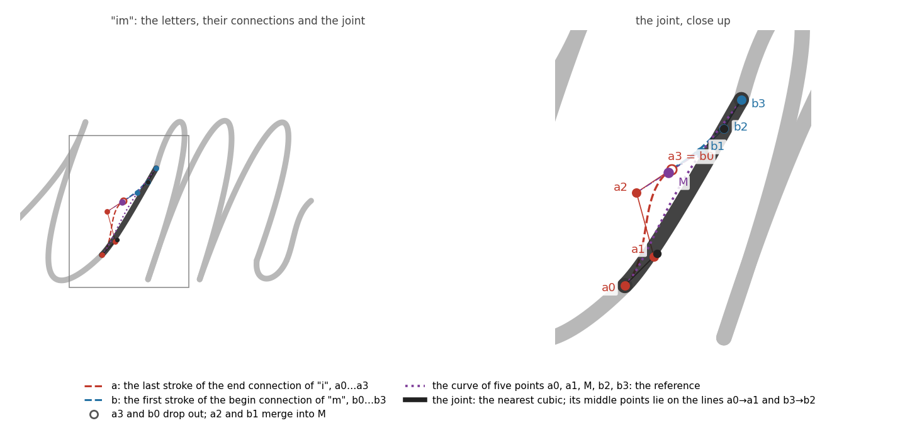
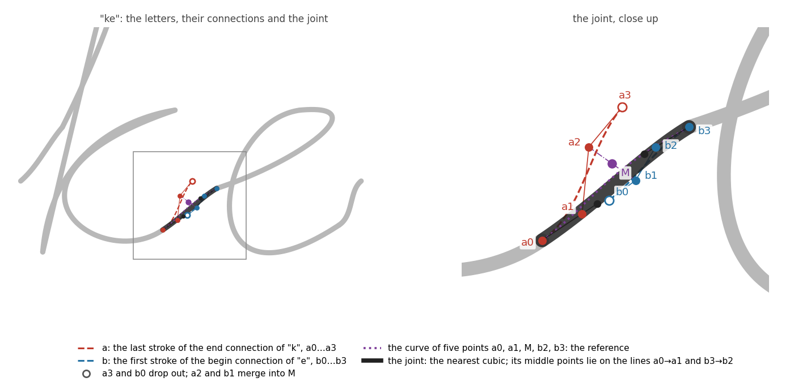
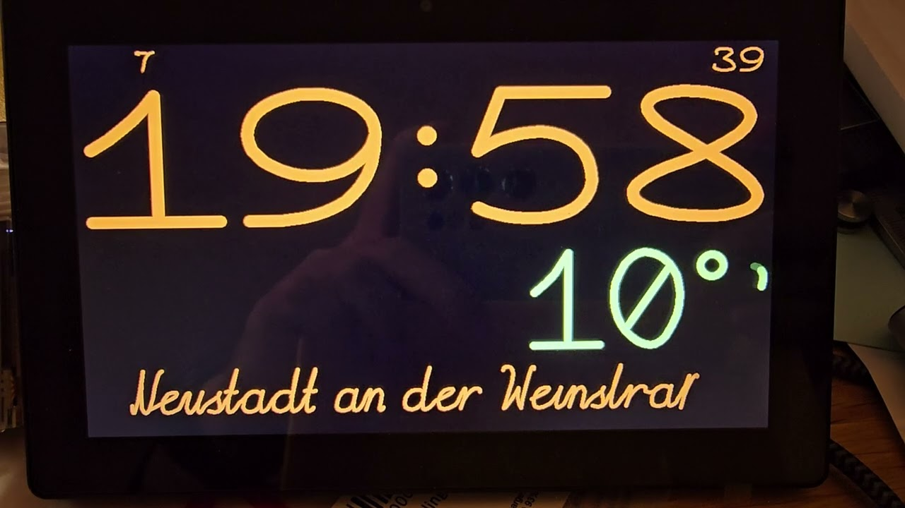

Bringing an ESP32 to Life: A Handwritten Font and Morphing
==========================================================

[Русская версия](./README-rus.md)

A clock on an ESP32 with a 320x240 display. The time, the temperature, and the
city name are drawn in a handwritten font built from Bézier curves: the digits
of the time flow into one another, and the temperature and the city are written
out stroke by stroke. The weather icon is made of dots and flows smoothly from
one icon into the next.

# Motivation

A clock tells you the time, and you get it at a glance: you look, you know.
Good design makes it easier to spot; animation makes it feel alive. Do you need
the animation? No. It's a finishing touch, the kind an artist adds: everything
works without it, and with it the thing is a pleasure to look at. This article
is about how to pull off that kind of touch on a microcontroller.

## "NICE TOUCH, DUDE"

After the [Bézier curve clock](https://habr.com/ru/articles/818873/) (in
Russian) that I built in 2021, I got the idea of doing an entire handwritten
font the same way. The existing formats, TTF and OpenType, don't work for this,
and not because they're hard to parse. They store the outline of a letter, the
boundary of a fill, while a handwritten font needs the path of the pen: the
order of the strokes, their direction, where the pen leaves the paper, and how
a letter joins its neighbor. None of that is in an outline, and you can't
recover it from one. So I needed a format of my own: simple, but more general
than the one in that clock, where any digit fit into three curves and, in
theory, into two if you were willing to give up on looks. I had to start with a
font editor, [hw-fonts](https://github.com/jef-sure/hw-fonts). I threw it
together in Vue with no build system at all: open `index.html` on your own
machine and you can load a font you saved earlier or download the result of
your editing (more on it in [The editor](#the-editor)).

The next touch was morphing fonts described by the coordinates of their dots:
[the dot-matrix clock](https://habr.com/ru/articles/817927/) (in Russian).

Then came an intermediate step: live [morphing in the Game of
Life](https://habr.com/ru/articles/1081830/) (in Russian).

That step led to the next one, [morphing between the glyphs of a
font](https://github.com/jef-sure/cyd-dotview-morphing), although the font was
really just a source there, and what it actually does is morph between any two
matrices. The work moved from one idea to the next and left a handful of
possible strategies along the way. Out of that grew a separate framework for
morphing between matrices in
[dgx](https://github.com/jef-sure/esp32-component-dgx) (more on it in
[Dot morphing](#dot-morphing)).

And all of it for a "nice touch." Simply because I like bringing information to
life, and because I like programming as a kind of art. Microcontrollers come
with their own limits, and that turns into the challenge: how do you get around
them?

A warning: this is a long read. Five years have passed since the idea first
came up, the experiments and the search for ideas took a long time, and if I
cut the story short it stops holding together.

# The 2021 clock

I picked up the idea on a channel about ESP32 programming: someone showed a
clock made of six displays, one digit on each, and named the source, the
Bézier Clock project in JavaScript by Jack Frigaard. There is an article about
the original project on Habr, [A Bézier curve
clock](https://habr.com/ru/articles/236455/) (in Russian). I never looked at
how it was done there: I decided right away to do it my own way, and first I
checked what the transformation looks like on a display. [The code of that
experiment](https://github.com/jef-sure/digits_morping_dgx) still exists, and
the video of it is below, in the section about pairs of curves.

In my clock every digit was three cubic Bézier curves. To begin with, I decided
that every symbol had to fit into a 100x160 box, with the control points
allowed to fly outside that grid as long as they stayed within 0–255, so that
each coordinate fit into a `uint8_t`: that was my attempt to squeeze the
description of a scalable font into a few bytes. I couldn't find an editor for
fonts like that, so I just pictured the control points in my head and checked
by experiment how well they worked. It came out not bad at all, and I had all
the digits picked fairly quickly. I wasn't after perfect lines, and that was
one reason picking them from imagination alone went so fast.

That clock left some questions behind. The Wi-Fi password and the service keys
were set in `sdkconfig`. That was the accepted standard in those years; it's
how articles, magazines, and tutorials did it: you describe the parameters you
need in Kconfig, set the SSID and the password in menuconfig, and use them in
the program as constants from `sdkconfig.h`. The scheme is fine for a personal
project, but if you want to give the thing to someone as a gift, you have to
either teach that person to compile your firmware or ask them for their Wi-Fi
name and password. Not a great scheme, to put it plainly.

The second question was finding the city automatically. Same problem: the
weather needs a specific place, and setting it through Kconfig is the same
problem again. In the end I went with a service that finds your location by IP
address. At home it usually guessed right and sometimes named the next town
over. But on someone else's network it could show a city a few hundred
kilometers away.

The third problem follows from the second: the time zone. Luckily the same
service returns it, so that one is at least partly solved. But relying on a
third-party service for your time zone... What if nobody knows the key for it,
or the key has stopped working?

The bitmap font was not a problem: I wrote a converter, `font2c`, that
rasterizes a font to monochrome through FreeType and writes the `Arial12.h`
and `Arial12.c` I need to add to the project. The rasterizer turned out to be
the problem: not every font comes out well in monochrome. So I had to hunt for
ones that did. A city name can run to any number of characters, so I also had
to come up with a way to estimate the size of the name in a given font and pick
the best fit. I hadn't invented scaling for bitmap fonts back then...

That is where the idea of a handwritten font came from: the same approach as
the digits, with curves that scale to any size. Drawing letters in my head the
way I had drawn digits no longer worked, and that is how the hw-fonts editor
mentioned above came to be. I drew a Latin font in it, and there the whole
thing stalled for several years.

What stopped me was the joints between letters. Handwriting is written joined
up, and the move from one letter to the next has to be a smooth curve that
adapts to its neighbor. If you just butt the tail of one letter against the
start of the next, which is what I had counted on at first, you get a kink or
an extra loop at the joint, and you end up with more points than a curve needs.
I didn't find a solution then. I shelved it "until better times."

In 2026 the font got its Russian alphabet, the graphics library
[dgx](https://github.com/jef-sure/esp32-component-dgx) gained support for
fonts like this, and this clock got to be the first project built on them. The
questions about setup, location, and time zone were closed along the way; see
the section on setup.

Handwritten text in dgx, before there was a clock around it. The animation is
the screen of the demo drawn on a PC by the same dgx code that runs on the
board; [the video](https://youtu.be/3zXTnylonLs) shows the board itself writing
a phrase in Russian:

# Bézier curves on a microcontroller

A cubic Bézier curve is defined by four points: the two ends and two more that
the curve is pulled toward. It can bend twice, in opposite directions, like the
letter S. The handwritten font also has quadratic curves, defined by three
points: the two ends and one that the curve is pulled toward. A curve like that
is an arc of a parabola and bends only one way. Where that is enough, it's
simpler to draw and simpler in the editor. For the details, see
[Wikipedia](https://en.wikipedia.org/wiki/B%C3%A9zier_curve).

Image: Chris828, Wikimedia Commons, public domain.

A letter made of such curves is a few strokes, each one a curve of its own, and
on paper there is nothing to it. On a microcontroller there are three
difficulties, and this article is really about them.

The first is segments. A microcontroller knows how to draw straight lines, so a
curve is some number of straight segments. Too few segments and you see the
corners; too many and it takes too long. How many you need depends on the
curvature and on the size on the screen, and every curve has its own answer.

The second is thickness. The line has to be thick, and a thick segment is not a
line but a shape. Where two segments meet, a wedge is left open on the outside
of the turn, and something has to close it. In 2021 a circle at every joint
closed it, and the circles ate up to half of the drawing time, even on a
virtual screen.

The third is animation. Every frame of a transformation is a new picture, and
you can't draw it straight on the display: you would see the old one being
erased and the new one appearing. So the frame is drawn in memory, on a virtual
screen, and transferred to the display over SPI. The hours-and-minutes band,
320x100 at two bytes a pixel, is 64 KB, and on a 40 MHz bus it takes 17 ms to
send. Of the ESP32's 520 KB of SRAM an application gets about 300, and Wi-Fi
and TLS live in there too; a 320x240 screen at two bytes a pixel would take
half of it. Assuming the heap even had a contiguous block that size, one fit
for sending directly by DMA.

How I dealt with them is covered below, in "Graphics" and "Morphing," but that
is still a long way off: first the font itself, because without it there is
nothing to draw.

# The font

I drew the `font0ss` font in the editor, and it ships with dgx. It has the
Latin alphabet with the German letters, the Russian alphabet, digits, and
punctuation: 153 symbols, 686 elements of four kinds.

| Kind | Points | What it is |
| --- | --- | --- |
| `curve` | 4 | a cubic Bézier curve: start, two control points, end |
| `curve3p` | 3 | a quadratic Bézier curve: start, one control point, end |
| `line` | 2 | a straight segment |
| `dot` | 1 | a dot |

Cubic curves are the overwhelming majority, 619 of the 686. The other kinds are
used where a cubic is overkill: the bar of the "7" is a straight segment, and
the dots over "ё" are dots.

## The editor

Outline fonts don't store the path of the pen, hence a format of my own and an
editor of my own.

[The hw-fonts editor](https://github.com/jef-sure/hw-fonts) was written in 2022
with Vue and Vuex; I moved it to Pinia recently, when I came back to it. The
libraries are loaded as ready-made scripts from a CDN, and the font is stored
in a JSON file. In the early days, when I needed to make similar letters, I
simply copied the matching pieces of JSON into a new codePoint.

The grid is 256x256 and the coordinates are integers from 0 to 255: a point
fits into two bytes, one per axis, just as in the 2021 clock. Back then that
was for the sake of memory; now it's more of a habit, but a convenient one for
a microcontroller: on that side the points are multiplied by a scale and a
polyline is drawn, and fractions have no business there. Inside the grid there
is an active area, 100x202 cells in `font0ss`: the width of a character slot
and the height of a line. Around it are margins, which is where the control
points of the curves go, along with the tails of letters that reach into their
neighbors.

A symbol in the editor has four sets of elements, and each has its own part to
play in writing. The main strokes are the drawing of the letter itself, in the
order the hand makes them. The postponed strokes are what the hand adds once the
word is finished: the dots over "ё," the crossbar of "t," the bar of "7." The
begin connection and the end connection are the strokes by which the pen
arrives at the letter from the previous one and leaves for the next; they are
not part of the letter's drawing, they are transitions. Lowercase letters have
connections on both sides, capitals only on the way out, and "V," "W," the
digits, and the punctuation marks have none.

Besides the symbols, the file holds helper lines shared by the whole font:
horizontals at the height of the capitals and of the lowercase letters, two
slanted lines for the slant, and two verticals for the edges of a letter. These
are the guides I used to keep the heights and the slant the same across all the
letters. They are not part of any symbol and never reach the microcontroller.

Everything that can be computed ahead of time, the editor computes on save: the
dimensions of a symbol, the length of each stroke, and the number of segments
to draw it with. All the microcontroller has to do is read. The length and the
number of segments are needed for more than drawing: together they make up the
effort of a stroke, which later lets the pen write at different speeds on a
straight line and on a curl; see [The pen](#the-pen).

## The path of the pen

A symbol is strokes in the order the hand makes them, and the order here is not
a formality. The font is designed so that text can be written the way a hand
writes it: letter by letter, stroke by stroke. That is why the dot over an "i"
can't be part of the letter: the hand puts it there once the word is finished.
In joined-up writing the end of one letter and the start of the next are joined
by a single curve; digits are written separately and have no connections.

I tried to get by with as few curves per symbol as possible, even at the cost
of an exact shape: the main drawing, not counting connections and postponed
strokes, takes three elements on average and seven at most. There are three
reasons. The fewer the curves, the less there is to compute on the
microcontroller. The simpler the morphing: turning three curves into four is
easier than turning twenty into thirty. And the less there is to draw: it is
extremely laborious work, one Latin font took me a month, and by the end I was
tired and could feel I had run out of steam.

The letter "i" in the editor. There is one main stroke, and the dot is stored
separately, as a postponed stroke. To the left and right of the letter you can
see its connections, begin and end:

## Joining letters

A letter's connections are drawn by hand in the editor, one for the way in and
one for the way out, and are made of ordinary strokes of the font. How to get
one smooth curve out of the end connection of one letter and the begin
connection of the
next is something I never did solve in 2022: two cubic curves have eight
control points, one has four, and everything I tried gave either a kink or a
loop. That is where the work stopped.

In the end the solution is this. The last stroke of the end connection and the
first stroke of the next letter's begin connection are merged into one. Their
two ends, the ones that meet in the gap between the letters, drop out of the
eight points, and the two control points next to those ends merge into one,
halfway between them. Five points remain: the ends of the connections, the
direction points next to them, and that midpoint. That is a fourth-degree
curve, and the font draws only cubics, so the nearest cubic is used instead.
Its ends are the ends of the connections, and its two middle points lie on the
lines along which the connections were drawn: the pen leaves one letter and
arrives at the other in the given directions. How far along those lines the
middle points sit is found by the smallest deviation from the five-point curve,
measured at seven of its points. A connection that has nothing to join is not
written: a word neither begins nor ends with a dangling tail.

Here is how it looks on two pairs from `font0ss`. Gray is the letters and the
other strokes of their connections; dashed, the two strokes being merged, with
their control points; dotted, the five-point curve; black, the cubic the joint
is drawn with.

For "i" and "m" the ends of the connections meet at one point, and the joint
stays close to the drawn connections:

For "k" and "e" they don't meet: the tail of "k" is drawn upward, toward `a3`,
while the start of the connection of "e," `b0`, lies lower. If the pen followed
the tail to its end and then went into "e," you would get a loop. The joint
throws out both ends and goes straight across, and the five-point reference and
the cubic nearly coincide, which is the whole point of the fit:

The letter "ж" with its connections. Black is the strokes themselves on the
grid; the blue dots and thin lines are the control points of the curves. The
begin connection comes up to the letter from the left, and the end connection
leaves it up and to the right:

## Units and scale

The font is drawn on the editor's grid, and all of its numbers are cells of
that grid, not pixels: the letter "o" in `font0ss` is 49 cells wide. So the
font has no size. It gets one on output: every coordinate is multiplied by one
fractional number, and out come pixels. That number is the scale, and there is
nothing special about one: at a scale of 0.5 that same "o" takes 25 pixels on
the screen, at 0.33 it takes 16, at 2 it takes 98. One and the same font works
for the seconds line and for a splash screen that fills the display.

The font has no line thickness either: strokes are curves with no width, like
lines on a drawing. The pen sets the thickness: along with the scale, the
output call is told how many pixels wide the line is. The pen doesn't depend on
the scale: the same letter at the same size can be written thin or bold.

The scale can be set separately for width and for height. If the two are the
same, the letter comes out the way it was drawn, only larger or smaller.

## Scale in the clock

The temperature is drawn with one scale for both axes. So is the city name, as
long as it fits its place across; a long name is not shrunk but squeezed
horizontally, the letters keep their height, and the pen slims down along with
it. A short name is not stretched to the full width. The digits of the time
always have two scales, across and down, and they are computed from the room
on the screen. The hours-and-minutes line is divided into slots, one per digit.
The widest digit of the font has to fit a slot across and the tallest has to
fit the line down; that gives two numbers, how many pixels a cell takes across
and how many down. The proportions of the font are not preserved.

Only the control points are stretched: `x` is multiplied by one scale and `y`
by the other, while the pen stays round and the same thickness in every
direction. So a stretched digit has vertical and horizontal lines of the same
weight, unlike lettering stretched in an image editor, where the horizontal
strokes get fat.

The clock picks the pen thickness itself, and it is the clock, not the font,
that ties it to the scale: the pen is 9 font cells times the scale, so the line
grows and shrinks with the letter. At a scale of 0.5 that is 4–5 pixels, and at
a scale of 2 it is 18. With two scales the geometric mean is used: on a
320x240 screen that comes to 6 pixels for the hours and minutes and 1 pixel for
the seconds.

The digits differ in width; a one is narrower than a zero. The slot is the same
for all of them, and a digit is shifted to the middle of it, so the time
doesn't slide around the screen when a one replaces a zero.

That kind of stretching doesn't work for handwritten letters: with different
scales on the two axes the slant and the curves would drift, and you would
notice. The digits can take it: in `font0ss` they are upright and even, too
even for handwriting, really, but they read well from a distance and stretch
in height with no harm done.

## From the editor to the microcontroller

JSON is the editor's format, general and easy to edit, and there is no reason
to parse it on a microcontroller. The `font2c` utility from dgx turns the file
into C tables: the same data under the same names, and the whole font takes
17 KB in the firmware. It already handled TTF fonts, which is how the weather
icons got into the clock; now it handles handwritten ones too. While it's at
it, `font2c` checks pairs of symbols: it puts each one after every other the
way a line of text would and names the pairs whose lines come closer than the
thickness of the pen. Going by that list, I moved apart the "7" and the
lowercase letters after it, the "Ф," the parentheses, and the punctuation
marks.

# The pen

Writing is text drawn not all at once but only up to the point the pen has
reached, and that point moves forward with time. Nothing has to be erased: the
pen only adds ink, each step draws something new, and text finished in any
number of steps matches, pixel for pixel, text drawn in one go.

The question is what to measure the pen's position in: what does "the pen is
halfway" mean?

## Effort

The obvious choice is the curve parameter: every stroke runs `t` from 0 to 1,
so put the pen at `t`. That falls apart right away. The parameter doesn't move
evenly along a Bézier curve, and strokes differ in length many times over, so
a long straight line and a tiny curl would take the same time. The pen would
sprint, then crawl.

The second option is more honest: the length of the path traveled. The pen
moves at a steady speed, but a hand doesn't write that way: it is fast on a
straight line and slow on a curl. Steady writing on a screen looks mechanical,
like a plotter, and I didn't like it.

So I introduced a third measure, effort: length plus a charge for curviness.
Every stroke has its own:

    effort = length + k × number of segments

The length is the pen's path along the stroke. The number of segments is a
measure of curviness: the tighter the curve, the more straight segments it
takes to draw. The coefficient `k` says how many units of path each segment
costs. With `k = 0` this is the second option, and the pen moves evenly.

I picked the coefficient by eye, by how the writing looks on the screen; the
clock uses `k = 6`. An example from `font0ss`: the digit one has a path of 271
and 5 segments. The letter "o" has a shorter path, 208, but 23 segments. At a
steady speed the one would take longer to write. With `k = 6` the effort of
the one is 301 and that of the "o" is 346, so the round letter takes longer
than three nearly straight strokes, just as it does for a hand.

A dot has no length, but it does take time. It, and every move of the pen
through the air, is given the least effort there is, the same as a hyphen: 44.

The microcontroller computes neither the length nor the number of segments. A
stroke never changes, so the font editor computes both numbers once, when it
saves the font, and stores them next to the stroke. All the microcontroller
has to do is read them and add them up.

## Pace

The pen spends effort at a constant pace. The digits of the hours and minutes
are written at a pace of 3000 units a second, the city and the temperature at
1500. The time since the writing began, multiplied by the pace, says how much
the pen has spent so far, and therefore where it is now. However many frames
have been drawn by that moment, the pen is where the clock says it should be.
The transformation of digits uses the same trick; more on that below.

It takes three steps to get from effort spent to a pixel. First, find the
stroke it falls on: all the strokes before that one are finished. Then find
the place on that stroke, measured along the polyline rather than by the curve
parameter, so that the pen neither crawls nor jumps on segments of different
lengths. Finally, the segment under the pen is drawn up to where the pen has
got to, with a round tip.

The writing time doesn't depend on the scale. Effort is counted in font units,
not pixels, so large text takes as long to write as small text: the pen simply
moves faster on the screen. The time depends only on the text itself and on
the pace. At 1500 units a second the pen writes "Frankfurt am Main" in 5.2
seconds; at 3000 it would take 2.6.

## What the pen writes

The pen writes:

  1. The time at power-on, digit by digit, in about a second. After that the
     digits only flow into one another;
  2. The city name, letter by letter;
  3. The temperature. It changes rarely, so it doesn't need morphing. The pen
     first erases the characters that changed, along the same path it wrote
     them and twice as fast, and then writes the new ones. The degree sign
     sits at the right edge, and the digits and the minus sign before it stay
     in fixed places;
  4. The letters "Z" and "W" in the top row, while the clock is waiting for
     the time and the weather after power-on: the pen writes the letter,
     erases it, and writes it again.

There is no real erasing here; it's a trick: to remove what was written, the
pen writes the same thing once more, along the same path and at the same
thickness, only in ink the color of the paper.

The font has no "℃" sign. It is assembled on the spot: a ring in the upper left
corner and a narrow letter "C" from the font, together the size of one digit.

The minus before a number is not a hyphen. The hyphen in the font sits at the
middle of the lowercase letters, which is where it belongs in a name like
"Rostov-on-Don." In front of digits it ends up too low and looks like an
underscore that has crept upward. So `font0ss` has a separate minus sign: a
bar at half the height of the digits, 31 units above the hyphen. The font
doesn't swap one for the other on its own; the minus is put there by the code
that writes the number: the temperature gets the minus sign (−), and the city name keeps
its hyphen (-).

Power-on in a video: the pen writes the time and the city name, and the
indicators in the top row show what the clock is still waiting for. Wi-Fi
connects first, then the weather arrives, and the time from the network comes
last.

# Morphing

Turning one digit into another works the way it did in 2021. The control
points of a curve travel in a straight line from the old place to the new one:
`P(t) = Pa + t*(Pb - Pa)`. A curve is built from the new points and drawn like
any other.

For that, the curves of both digits have to be of the same kind, and the
strokes in the font vary: dots, straight lines, quadratic and cubic curves. So
before a transformation they are all converted to cubics. A straight line and
a quadratic curve are raised to a cubic with no change of shape, and a dot
becomes a curve whose four points are all in one place. After that a digit is
a list of cubic curves, and a transformation is a list of pairs of such
curves.

## Pairs of curves

In 2021 every digit had exactly three curves, and they came in an order that
suited morphing: the first into the first, the second into the second. Here is
how that looked in the first experiment, with the digits flowing into one
another in a loop:

In the font the order is different: a digit is drawn the way a hand writes it,
and when the clock's digits started coming from the font, the transformation
got noticeably worse, and it took me a while to see why. Writing order is no
good for pairing: a nine starts with the oval and ends with the tail, a seven
starts with the top, and the top of one flew downward to become the tail of
the other. So the pairs are now chosen by search, so that all the points
together travel the shortest distance. A curve may also be taken from its
other end; it draws the same thing. For the digits of `font0ss` the distance
comes out 30% shorter on average than in writing order, and four times shorter
when a two turns into a nine.

The search is cheap: the best path is computed over the sets of strokes
already taken, of which there are 2^n rather than n!, and a digit has only a
handful of strokes. A symbol with more than ten strokes dgx would pair in
writing order.

Digits have different numbers of strokes, so not every stroke finds a partner.
An extra stroke is paired with a point: a curve whose four control points
coincide, at the spot where the pen finished writing the digit. From there it
is an ordinary pair: over the transformation an extra stroke of the old digit
shrinks into that point, and an extra stroke of the new one grows out of it.

## Position

The shift that puts a digit in the middle of its slot depends on the digit's
width, so it is different for the old digit and the new one. It changes along
with `t`: a one turning into a zero moves over to the zero's place on the way.

## Timing

The transformation of the hours and minutes takes half a second and ends
exactly when the second shown on the screen begins. For the other half second
the picture stands still: the eye needs time to read it. The seconds worked
the same way at first, but that pace felt a little too busy for a digit that
changes every second, so I shifted it: the seconds transform in 0.3 seconds
and stand for 0.7.

The parameter `t` in the formula is the fraction of the way traveled: at 0 the
screen shows the old digit, at 1 the new one, and in between an intermediate
shape. It is computed from time: how long since the transformation began,
divided by its duration. A quarter of a second in, `t = 0.5`, however many
frames have been drawn by then. If a frame took longer than usual to draw, the
next one simply lands a little farther along, and the transformation still
ends on time.

What goes into the curves is not that fraction itself but one smoothed by the
well-known smoothstep formula: `t*t*(3 - 2*t)`. It changes more slowly at the
beginning and the end than in the middle, so the digit starts and stops
gently.

## The frame

Every frame of a transformation is a new picture, and the old one has to go.
So the digits are drawn on a virtual screen and reach the display finished,
with no flicker. There are as many frames as there is time for: about a
hundred in half a second when one digit of the hours or minutes is changing.

Only the slot of the digit that is changing is erased and redrawn. A digit on
its way to the next one never leaves its slot: that has been checked on the
board for all 90 pairs of digits, at both sizes. The other digits and the
colon stay as they were drawn, and only that one slot is sent to the display.

There are two lines: hours with minutes, and seconds. The minutes line
transforms once a minute and the seconds line every second (Captain Obvious
says hi), and while a transformation is under way the line is redrawn frame
after frame.

The seconds are small, a sixth of the height of the hours and minutes, in the
corner above the minutes. Large seconds are always moving, and they catch the
eye: you glance at the clock and get stuck. I didn't want to drop them
entirely; sometimes you do need the seconds. At this size you can see them if
you look for them, and they don't distract.

# Dot morphing

The second kind of morphing in the clock works on dots, not curves: that is
how the weather icon flows. It didn't come from the 2021 clock but down another
branch, through three projects in a row.

First there was [the dot-matrix clock](https://habr.com/ru/articles/817927/)
(in Russian) on two OLED displays. Every symbol there is described by the
coordinates of its dots, and the order of the dots in the list is the
choreography: dot number `i` of one symbol flies to dot number `i` of the
other, and if the symbols have different numbers of dots, the shorter list is
padded with repeats of its last dot. An eight, for example, has more dots than
a nine, and in the transition the extra dots of the lower left arc simply
collapsed into the bottom dot of the nine. The order was chosen so that the
parts that don't change stay where they are during a transition. I made the
digits and a couple of symbols for degrees myself. For the weather icons I
started from a font of weather icons and reworked them by hand in the
[FontCreator](https://github.com/Llerr/FontCreator) editor, which lets you set
the index of every dot while you edit a symbol.

Next came an experiment with [the Game of
Life](https://habr.com/ru/articles/1081830/) (in Russian). Normally one
generation just replaces another, frame after frame. I wanted one to flow into
the next, and that is how the "living flow" came about. There is no need to
place dots by hand here; the rules of the game themselves say who flies where.
A cell is born when it has exactly three live neighbors. Those are its
parents, and a dot flies into the new cell from each of them. Three dots
arrive in one cell at once, and to keep it from blowing out, the brightness is
split evenly among them.

The third step was [morphing a pair of arbitrary
symbols](https://github.com/jef-sure/cyd-dotview-morphing) of an ordinary
bitmap font. A pair of symbols has neither an order of dots nor a rule of
birth, so the source for each new dot is picked automatically, from geometry.
The font is only a source of dots here: the transformation runs between any
two matrices. The framework in dgx grew out of those three projects: a matrix
of cells, a plan of "who flies where," a frame, and a renderer with glow, and
all the project has to say is where the next state comes from and how to
choose the sources.

A cell is either lit or not, and when one matrix gives way to another there
are four cases for its state. It was dark and stays dark: nothing happens. It
was lit and stays lit: the dot stays put. It was dark and lights up: a dot
arrives from somewhere. It was lit and goes dark: the dot leaves. That leaves
two questions: where does a new dot come from, and where does an old one go?

The answer to the first is this: a new dot comes from the nearest dot of the
old symbol that isn't yet serving as anyone's source. A dot that isn't going
anywhere itself qualifies too: it stays lit where it is and, on top of that,
lets a new one go. That is how "u" becomes "ü": the whole letter stays lit,
and the dots above it bud off from the tops of its stems. Each old dot serves
as a source once. The nearest one is found not for each dot separately but for
the whole matrix at once, vector by vector. A vector here is a shift, one cell
up, for instance. Take one vector, and every new dot checks whether the old
symbol has a free dot at exactly that shift from it. Then the next vector,
from short to long, until every new dot has a source or the free old dots run
out. A line that has moved sideways finds its whole old line with a single
vector and travels as a whole instead of falling apart. A new dot that got no
source appears from the center of the matrix. An old dot that nobody took and
that isn't in the new symbol is left over: that is the second question, and
I'll get to it below.

It didn't start out that way. At first there were two passes: neighbors, and
then, cell by cell, all the rings at once, so a cell early in the scan could
grab a source four cells away that the next cell had only three cells from
it. After the rewrite to vectors the flights got shorter on average: 4.1 cells
instead of 5.0. I measured that on the weather icons, the very ones the clock
shows.

They are also what the vector search helped most. The icons come from the
[Weather Icons](https://erikflowers.github.io/weather-icons/) font and,
unfortunately, aren't aligned with one another: the same cloud sits in
different places in neighboring icons and comes in different sizes. So a
transition from icon to icon often looks like a shift or a change of size.
Thanks to the vector search, the parts of an icon travel as a whole when that
happens, and the transitions don't look jittery. Sometimes it's even pretty:
when the weather changes, the sun behind a cloud "grows" its rays, and the
transition looks organic. It is in the video below.

At first the leftover dots simply faded out where they were. After some
discussion, a second way was added to that one: let them leave by merging into
the dots that stay on the screen, the ones nearest to them. The letter "E,"
turning into "F," used to lose its bottom bar: it just went dark. Now its dots
gather to the left, into the base of the stem. Looking for the nearest dot by
vectors alone turned out not to be enough: the right part of the bar would
have flown upward, into the middle bar, which is closer by rings. So a
leftover dot first walks along its own shape, neighbor to neighbor, to a dot
that stays, and only a piece cut off from everything searches by vectors. It
flies at full brightness for half the way and fades toward the end, already at
its target. In the clock the leftover dots of the weather icon leave this way,
no farther than eight cells: a cloud that got smaller doesn't melt, it pulls
in. The article, the project, and the library were all being edited at the
same time, and this went into dgx 0.4.8 while the text was being written.

Transitions of the weather icons on video, close up, already with the merging
of leftover dots:

A flight is drawn with two discs: the head moves with `t`, and the tail stands
still at first and catches up with it by the end. The brightness of the discs
is added into an 8-bit map, and a bright bridge forms between head and tail.
The map is blended with the previous frame, and the dot leaves an afterglow
behind it, like on a phosphor. The method is described in detail in the dgx
documentation: [Morphing dot
structures](https://github.com/jef-sure/esp32-component-dgx/blob/main/docs/morphing-en.md).

## The weather icon

The icons don't match the service's weather codes one for one; the mapping was
put together by hand in `main/weather.c`.

A 24-pixel icon is broken into dots, and each dot is 2 pixels on the screen.
When the weather changes, the dots of one icon fly to the places of the dots
of the other in one second, as described above, and over that same second the
color moves to the color of the new temperature. One pass of blur is applied
to the finished frame; it comes up in "Graphics": without it you can see the
jagged steps of a one-bit picture.

# Graphics

## How it was

In 2021 I tried to come up with an algorithm for choosing the number of
segments automatically, but in the end I settled for a fixed one: 13 for any
curve. For a small curve that is too many, for a large one too few. I did the
thickness by brute force: thick segments, with filled circles at the joints to
close the wedges. I'm sorry to say I was never happy with the joints, and when
I timed it, the circles alone turned out to take a third to a half of the time
to draw a symbol. Anti-aliasing mostly hid the flaws of the joints, and for
its sake the digits were drawn on 8-bit virtual screens, where a byte is an
amount of ink.

Every digit had its own virtual screen, 40x120, and the ones that had changed
were sent to the display. Two tasks drew on them, time and weather, and a
third, the main one, transferred them to the display: it was sent a message
that a frame was ready. While the message was on its way, the drawing task
could already have started the next frame, and the main task would have
transferred a half-erased screen. To keep that from happening, a semaphore
guarded the virtual screens: whoever draws or transfers holds it.

## How it is now

The editor counts the segments: for every curve it stores the smallest number
at which the polyline strays from the curve by no more than half a unit. On
output that number is multiplied by the square root of the scale. The right
half of the zero in `font0ss` needs 13 segments at a scale of 1, 10 at half
scale, and 19 at double. Funny thing: at a scale of 1 it comes to the very 13
I picked by eye in 2021. Or maybe my eye is just trained by now.

The square root is there because the deviation of a polyline from a curve
falls as the square of the number of segments: a curve twice as large needs
1.41 times as many, not twice as many. Saving on segments is worth it: the
drawing time depends on how many there are, not on the length of the line.

A segment is now a single convex shape: a rectangle with a flat start and, at
the end, a disc as wide as the line. The start is covered by the disc of the
previous segment, so there are no gaps at the bends whatever the turn. The
font draws in about 60% of the time it used to take.

The gain is in calls, not pixels. A shape is filled row by row: for every row
of the screen there is one call that paints a horizontal strip from the left
edge of the shape to the right. A call costs 1.3–1.9 µs almost regardless of
how many pixels are in the strip. Before, a segment and the circle at its
joint were filled separately, and where they overlapped the same screen row
was painted twice. Now there is one shape and it is convex: in any screen row
it has exactly one strip, and so one call.

The curves are no longer anti-aliased: the joints it used to hide are gone by
construction. Post-processing is still available, but only for dot morphing.
There, each frame can be run through a filter before output, and dgx comes
with a ready-made blur filter: a one-bit icon looks jagged without blur. The
weather icon uses it, one pass. What that filter once cost is told in
[Memory](#memory).

The 8-bit virtual screens stayed, even though the anti-aliasing they were
there for is gone. A byte is an amount of ink: 0 is paper, 255 is ink. A
screen like that has no color; the color appears when it is transferred to the
display: a table of 256 values says what color to show each amount of ink in,
from the color of the paper to the color of the ink. To recolor the time, at
sunset for instance, it's enough to recompute the table; the drawing itself
stays as it is. And eight bits instead of sixteen cut the memory in half: the
hours-and-minutes band, 320x100, takes 32 KB instead of 64, the temperature
band, 220x74, takes 16 KB, and the city name band, 320x46, another 15 KB.

A virtual screen is memory; the SPI bus plays no part in drawing on it. What
goes over SPI is the transfer of the drawing to the display, and not the
whole screen but only the part that changed. The screen knows which part that
is: every time dgx draws, it notes where. In one step the pen changes a few
pixels around its tip, and those are what go to the display. A frame of a
transformation erases and redraws only the slot of the digit that is changing,
and only that slot goes to the display.

dgx didn't have this; transferring a part of a screen appeared while I was
working on the clock. As long as the whole band went to the display, a frame
took 17 ms however many digits were changing, and it was a shame to spend
that on one digit.

While a digit is turning into the next one, the picture is redrawn many times
in a row. When one digit of the hours or minutes is changing, a redraw
together with the transfer to the display takes 4.4 ms instead of the old 17,
and about a hundred of them fit into the half second of a transformation. Two
adjacent digits take 8.7 ms, all four 15 ms. The seconds line is small, and
redrawing it takes 0.2 ms.

Exactly one task works with the display. I hold to the principle that one
party alone should work with a physical bus: no locks are needed, and what to
do is passed along in messages. I try to build things this way every time,
and it is also why none of the components I publish in the
[Espressif registry](https://components.espressif.com/components?q=namespace:jef-sure)
are thread-safe: one task owns the device, and there is nobody to protect it
from. The time, the weather, the city, and the wait indicators each draw on
virtual screens of their own and send that task a message: what to show and
where. Once it has sent the message, a task waits for nothing and goes on
with its own business.

There is no lock on a virtual screen either: at any moment it has one owner.
While a task is drawing, the screen is its own. A "show this" message hands
the screen to the display task, which transfers it to the display and hands
it back. A task waits only when it needs its screen again and the screen
hasn't come back yet: right before drawing on it. Until that moment it is
free, and that time goes to the other tasks.

The "screen is back" signal is a FreeRTOS binary semaphore, one per screen,
but it doesn't work as a lock. A task takes it before drawing and, when it
sends the message, doesn't give it back: the screen goes along with the
message. The display task never takes it and never waits on it; it only gives
it after the transfer.

There used to be a mutex here. Both sides took it, the owner of the screen
and the display task, which waited on it. It wasn't protecting any shared
data; it was standing in for that same handing of the screen from one to the
other. Now the handoff is explicit, and the display task waits for nothing.

That is also where the pace comes from. Over SPI you can't draw more often
than the screen gets to the display: the transfer takes time, and that time
is always enough. For a display on DSI the transfer costs almost nothing, so
there the source keeps the pace itself, the way a video player does: it
doesn't start the next picture until one frame of the display has passed
since the previous one.

For the details on curves, thick lines, and the font, see the dgx
documentation: [Handwritten text in
DGX](https://github.com/jef-sure/esp32-component-dgx/blob/main/docs/handwriting-en.md).

# Color

The time is silver by day, to be brighter, and copper at night, so it isn't so
glaring in evening light. The transition starts half an hour before sunrise
or sunset and ends half an hour after. Sunrise and sunset come in the weather
response.

The city name is light blue by day and, at night, the same copper as the
time. The wait indicators in the top row are always the same color as the
time.

The weather is dimmed at night too, but differently. Its hue stands for the
temperature and can't be changed, so only the brightness changes: by night it
drops to 60% of the daytime level, with all three components of the color
multiplied by the same number.

The color of the temperature and of the weather icon is computed by the
formula from the 2021 clock: 23 degrees is taken as the "comfortable" level,
and below it the color goes toward blue, above it toward red. After that the
color is leveled for brightness: the strongest of its three components is
always 224 out of 255. Without that, some colors would come out dimmer than
others, and a blue number in a hard frost would be harder to read than a red
one in the heat.

The weather color changes smoothly as well. When a different temperature
arrives, the icon and the number move from the old color to the new one in a
second, together with the transformation of the icon. The drawing isn't
touched: both the time and the weather are drawn as amounts of ink, and the
color is a table of 256 values that is recomputed for every frame of the
transition. The brightness of the backlight doesn't change in this version.
In the dot-matrix clock a photoresistor adjusted it to the ambient light;
here only the color changes at night, by the times of sunrise and sunset.

# The clock as a device

## Hardware

The board is a CYD (ESP32-2432S028), the Cheap Yellow Display: an ESP32 and a
2.8" 320x240 screen on an ILI9341 controller, the same screen as in 2021. The
board is very popular and inexpensive. I chose it because the display is
already soldered on and I don't have to check the wiring every time. It's
handy for all sorts of experiments to have one standard display hookup.

In 2021 I tried one large display and two smaller ones side by side and went
with the largest I had. The ESP32 was chosen for its Wi-Fi and its memory:
the virtual screens need a few dozen kilobytes of RAM. Now BLE for the setup
has been added to that.

The layout is made for this display: the time at the top, the weather line
under it, the city name at the bottom, with all the free space divided up
among them.

The size of the digits and the thickness of the pen depend on each other: the
pen needs room at the edges of a slot, and its thickness is computed from the
scale. So the layout is computed in two passes.

## Memory

The clock doesn't have much RAM, and here is where it goes. Virtual screens:
the hours-and-minutes band 32 KB, the temperature band 16 KB, the city name
band 15 KB, and the seconds line and the wait indicators together under 2 KB.
The glow of the weather icon: two brightness maps at a byte a pixel, 80x74
pixels, 12 KB. Task stacks: five at 4 KB, 8 KB for the weather task, 2 KB for
the button, 30 KB in all. Wi-Fi and the system take the rest.

The hungriest consumer isn't on that list, because it lives for one second:
the TLS handshake of a weather request. The service sends a chain of four
certificates with keys up to 4096 bits, and verifying it, together with the
TLS buffers, takes about 53 KB under ESP-IDF 5.5 and about 48 KB under 6.0.
That memory has to be there every 5 minutes, or the weather won't arrive.

| | ESP-IDF 5.5.4 | ESP-IDF 6.0.1 |
| --- | --- | --- |
| Free before a weather request | 71 KB | 73 KB |
| Left at the worst moment of the handshake | 19 KB | 26 KB |

That was measured right after power-on, while the wait indicators are still
on the screen. Once they have what they were waiting for, they go away along
with their task and give back another 7.5 KB: the band, the task's stack, and
whatever it was using.

Those indicators made for a story while this text was being written. Under
ESP-IDF 5.5 the weather suddenly stopped arriving: the handshake was one
kilobyte short for verifying a certificate. The memory had been taken by the
wait indicators I had added the day before. They live until the first weather
arrives, and the weather couldn't arrive while they were holding the memory.
First I turned off the blur of the weather icon: its copy of the frame cost
6 KB. Then, in dgx 0.4.9, the glow went from four bytes a pixel to two, the
one-pass blur learned to do without the copy, and it came back. Free memory
before a weather request went from 52 KB to 71.

The same thrift is behind two decisions described below, in "Setup": the BLE
stack is unloaded as soon as the network is set, and the settings page lives
in a boot of its own and doesn't share memory with the clock's screens.

## Setup

In the 2021 clock the Wi-Fi password and the service keys lived in
`sdkconfig`, that is, in the firmware. Now the project configuration holds
only the hardware, and everything that has to do with location, network, and
services the clock keeps in its own NVS, where it survives reflashing. It is
set in two ways: the Wi-Fi network from a phone over BLE, with the standard
Espressif app that is in Google Play and the App Store, and the rest on a web
page that the clock serves itself. Neither needs a computer.

### Network

In the dot-matrix clock the network was set through SoftAP: the clock brought
up its own access point. I dropped that: on the phone you have to connect by
hand to a new, unfamiliar access point. With BLE the phone stays on its own
network, and the app does everything else. Not the most convenient app, I
have to say. The provisioning protocol allows for arbitrary extra data of
your own, but the app can't handle it. If you need to set up several devices
at once, you'll be typing the same data into the app every time. Its
advantage is that the app already exists for both platforms: you don't have
to become an app developer yourself, write your own app for both platforms,
and so on. Too much hassle.

The app is called ESP BLE Provisioning. A clock that doesn't know a network
shows a QR code for it. The QR code carries the device name, `CLOCK-` plus
the last three bytes of the MAC address, and a proof-of-possession password:
the network can be set by the phone that read the code off the screen, not by
anyone who happened to hear the clock over BLE. The app sends the network
name and password, the clock tries to connect and answers the phone:
connected, wrong password, or no such network. After a failure you can send
another network.

When the clock already has a network and it needs to be changed, the old one
is set aside while the setup runs: if no phone shows up within 3 minutes, the
clock goes back to the old network and back to work. A clock with no network
waits for a phone as long as it takes.

BLE is needed only for that time. Network setup is a boot of its own: once it
has a network, the clock restarts, and in normal operation the BLE stack is
unloaded and its controller's memory is returned to the heap. As a side
benefit, the radio doesn't have to be shared between Wi-Fi and BLE, and Wi-Fi
runs without sleep mode: with it, the clock answered a request for the page
with a delay.

Before setup, the name on the network is `weather-clock-` plus those same
three bytes of the MAC address, so that two units in one house don't fight
over the name. Under the same name the clock answers as `<name>.local`. The
name can be changed on the page; letters, digits, and hyphens are kept, and
anything else becomes a hyphen.

Of several access points with the same network name the clock picks the
strongest one, not the first one it hears, and after a drop it reconnects in
2 seconds.

### The settings page

The BOOT button restarts the clock into settings mode. How long you press
means nothing, and there is no long press: in an enclosure the button may be
a touch button, and when a clock is being carried it's held however it's
held, and a finger may rest on the button for as long as you like.

Settings mode is a boot of its own. The press writes a request to NVS and
restarts the clock; the next boot picks up the request, erases it, and brings
up the page instead of the clock, and the boot after that is the clock again.
That way the page has the screen and the memory all to itself: the web server
doesn't have to share RAM with the virtual screens and the tasks of the
clock.

Once it's up, the clock connects to the network and shows the address of the
page as text and as a QR code, with the signal level next to it: a page that
loads poorly is explained by a weak signal. The page waits 5 minutes, and
then the clock goes back to work. Pressing the button again closes it too. If
the clock couldn't connect to the network within a minute, the next boot
offers to set a different network over BLE, and if nobody comes, the clock
goes to work with the old one.

On the page: the OpenWeatherMap key, the location, the name on the screen,
the time zone, the host name, and two checkboxes. "Clear WiFi data" is for
when the network has changed: a different router, a different password, the
clock has moved. The clock forgets the network and shows the QR code for
setup from a phone again. "Clear all settings" is for when the clock goes to
another person, as a gift for instance: the network, the service keys, and
the location with its name are all erased. Saved settings take effect with a
restart.

The page is styled with Bootstrap, and its own JavaScript amounts to three
functions: hiding the fields that aren't needed for the chosen way of finding
the location, and asking again before "Clear all settings."

#### How the page is made

A web page on a microcontroller is usually either entirely static or
assembled in code from scraps of HTML in `printf` calls, and then you can
neither open it in a browser nor hand it to a web designer. Here the page is
an ordinary HTML file, `misc/index.html`. You can open it from disk and see
what it looks like, and edit it in any editor; the field values in it are
marked by placeholders such as `%HOST_NAME%` and `%TIMEZONE_OPTIONS%`.

I came up with this back for [the dot-matrix
clock](https://habr.com/ru/articles/817927/) (in Russian), along with the QR
code for setup. There a Perl script cut up the HTML. I had to move to Python
because ESP-IDF drags it along in any case, while a person may well not have
Perl.

The idea itself I picked up from the "real" template engines in big systems:
they, too, first parse a template into constant pieces and calls to code, and
then run the finished list. Here the parsing has been moved to build time,
and only the running is left for the microcontroller. I haven't seen this
approach in other people's microcontroller projects.

At build time the script `misc/split_to_template.py` minifies the file,
removing comments and the whitespace between tags, and cuts it into pieces at
those placeholders. The pieces become a header file with an array of pairs,
"constant text, handler": the constant text is the piece of HTML up to the
next placeholder, and the handler is a function that outputs the value for
that placeholder. The function's name is made from the placeholder's name:
`%HOST_NAME%` becomes `http_data_host_name`. The clock's page has eight
placeholders and nine pieces, 4 KB of HTML after minifying.

The array is included in `main/webserver.c`, where those functions are
written. The compiler checks that they match: a placeholder added to the HTML
without a function, or a function without a placeholder, is a build error,
not an empty field on the page that somebody notices six months later.

A request for the page is handled by walking the array: send a constant
piece, call the handler, on to the next piece. Everything is sent in parts,
chunked, straight from flash: the page is never assembled in memory, there is
no buffer for it, and there is no template engine. A handler sends its value
with `&`, `<`, `>`, and quotes replaced by HTML entities, so that a key or a
name containing one of those characters doesn't break the page. The only
handler with a buffer is the list of time zones: that is about 600 `<option>`
lines, tens of kilobytes, and they are collected a kilobyte at a time and
sent in batches rather than one by one.

The form comes back as a form-encoded `POST`, no more than 2 KB, and is
parsed in place in the string received: `%XX` and `+` are decoded right where
they were read, and no memory is needed for a copy. The fields go into the
settings structure, and the whole structure is compared with the current one:
if nothing changed, nothing is written to NVS and the page answers "no
changes." After parsing, the browser is redirected to a result page, so
refreshing the page in the browser doesn't submit the form again.

The settings are stored in NVS as one record: the structure and its version
number. When a field is added, the number goes up, a record of the previous
version is read as the beginning of the new one, and the new fields get their
defaults. That lets the firmware be updated without losing the settings. A
record with an unknown version isn't read at all, and the clock starts from a
clean slate.

On a board with a DSI display there is one more record in NVS, and this one
isn't a setting: the measurements of the board. On first start dgx measures
from what size on a piece of a picture is better handed to the hardware
transfer than to the processor, and the clock saves the result so it doesn't
have to measure on every power-on. The measurement takes 0.07 s and doesn't
show on the screen. "Clear all settings" leaves this record alone: it
describes the board, not the owner.

### "WHERE U FROM"

The location is set in a single text field, and it is read in one of three
ways: coordinates ("52.52,13.40"), a city with a country ("Berlin,DE"), or a
postal code with a country ("10115,DE"). Coordinates are taken as they are;
anything else is looked up once with the OpenWeatherMap geocoder: first as a
name and then, if that finds nothing and the text starts with digits, as a
postal code. The coordinates and the name it finds are saved and aren't
looked up again until the text in the field changes.

Cities that share a name do exist: Germany has two Frankfurts, one on the
Main and one on the Oder, and given just the name the service will pick one
of them on its own. A postal code or coordinates are more reliable.

You can set your own name for the screen. The service names a place its own
way: the full name of a city where the short one would do, or the city where
the name of the district is what people actually use. An empty field means
the name from the service, which is shown in that field in gray as a hint. A
location given by coordinates has no name; it is taken from the weather
response and saved as well.

The city name comes from the service as is, and the font has only the Latin
alphabet, the German "ä," "ö," "ü," "ß," and the Russian alphabet. A letter
of another language, with a stroke, a caron, or a tail, is written without
its mark: "Kraków" as "Krakow," "Málaga" as "Malaga," "Łódź" as "Lodz."
German names are left alone: "Köln" stays "Köln."

The substitution goes by a table in `main/city_face.c`. It was put together
by hand and covers two Unicode blocks, Latin-1 Supplement and Latin
Extended-A, the characters from U+00C0 to U+017F, 192 in all. Each letter in
it is mapped to the same letter without its mark, and letters like "æ," "œ,"
and "þ" to two: "ae," "oe," "th." That is enough for the European languages
written in Latin script. A character that is in neither the font nor the
table is skipped.

Finding the location by IP address through [ipinfo.io](https://ipinfo.io) is
left over from the 2021 clock, and it needs a key of its own. Back then that
was the only way the city was found, and for me it regularly came out as the
next town over: an error of tens of kilometers is par for the course with
this method. For the weather and the time zone that hardly matters, but it's
nicer to read the truth on the screen. So now it is off until someone turns
it on. When it is on, it asks for the location again every 10 minutes: a
clock set up that way may be on the move.

### Time

The time comes from pool.ntp.org as soon as the clock has an address on the
network. Until then the clock runs from the build time of the firmware, and
what's on the screen isn't true.

The time zone is either chosen from a list or found automatically. The list
is made at build time from the tz database of the machine doing the build:
for every zone the script `misc/generate_tzones.py` takes the POSIX rule
string from the zone's file, for example `CET-1CEST,M3.5.0,M10.5.0/3` for
Berlin, and the country and the coordinates of the zone's main city from the
`zone.tab` table. In October 2026 that came to 598 zones. The database itself
isn't on the microcontroller, only this table, and the library works out
daylight saving time from the rule string.

When no zone has been chosen, it has to be worked out. The weather response
has no zone name: only the country of the place and its offset from UTC in
seconds at that moment, 7200 for example. The offset alone isn't enough: it
doesn't tell you whether the clocks change here, or when. So of that
country's zones, the ones with the same offset right now are taken; of those,
the one nearest to the place by coordinates; and if several zones have the
same rules, the country's main zone. The zone that was found is saved, and
from then on the clock lives by its rules, daylight saving time included.
Until the weather arrives, the clock shows UTC. If no suitable zone turns up
in the table, the bare offset is used, with no daylight saving time.

A ready-made zone name, like `Europe/Berlin`, comes only when the location is
found by IP address: ipinfo.io supplies it, and then there is nothing to work
out.

### "HOW R U"

The weather is requested from [openweathermap.org](https://openweathermap.org/),
API 2.5, current weather by coordinates, every 5 minutes. After a failure it
is asked again in 30 seconds, and then the interval doubles up to those same
5 minutes. The key is free, and it is this particular request that is free:
the newer One Call API 3.0 from OpenWeatherMap needs a separate subscription
with a card on file. Without a key the clock shows only the time. Besides the
weather and the temperature, the response supplies sunrise and sunset for the
change of color, the name of the place, and a hint about the time zone.

Entering the settings on video: the button, the restart, connecting to the
network, the address of the page.

Once connected, the clock shows the address of the page as a QR code and as
text:

The page itself:

## Power-on

After power-on the clock writes the time and the saved city name. What it is
still waiting for is shown by three indicators at the left of the top row,
across from the seconds, each in its own place. The Wi-Fi sign while it is
connecting: the arcs appear one after another. Then the letter "Z" while the
time is being requested from the network, and "W" while the weather is being
requested. Once an indicator gets what it was waiting for the first time, it
goes away. When all three are gone, the row is empty: everything is working
as intended.

## Building

You need ESP-IDF 5.2 or newer: the lower bound is set by dgx, and the clock
has no version requirements of its own. The 5.2 comes from the I2C bus: it is
written on a driver that earlier versions don't have. The rest of the API I
use is compatible with that version, but my local version is higher: I built
and tested under 5.5.4 and 6.0.1, on one board, and didn't test real
operation under versions 5.2 through 5.4. The component manager will download
the components, dgx 0.5.3 among them.

The versions are named as of publication, October 2026. dgx 0.5.3 was the
latest then, and 5.5.4 and 6.0.1 were the ESP-IDF versions I had on hand.

    idf.py set-target esp32
    idf.py build
    idf.py -p /dev/ttyUSB0 flash monitor

### Wiring the display

On the CYD board everything is already connected. For another board the pins
are set in `main/display.c`:

| Display | Pin |
|---------|-----|
| MOSI    | 13  |
| MISO    | 12  |
| CLK     | 14  |
| CS      | 15  |
| DC      | 2   |
| BLK     | 21  |

The button is GPIO 0.

## Trade-offs

  1. There is no forecast, only the weather right now. OpenWeatherMap has one,
     and it's free, 5 days in 3-hour steps, but that is a different request
     and different parsing, and the clock doesn't have it;
  2. Choosing the zone by the nearest place sometimes gets it wrong where a
     zone without daylight saving time is nearby: El Paso will get the zone
     of Phoenix. Then the zone has to be chosen on the page;
  3. Letters of other languages with diacritics in a city name are written
     without them; see the section on location. The font has no Chinese
     characters and no Arabic script: a name like that will be written in
     part or not at all;
  4. The settings page is styled with Bootstrap, and the browser loads its
     CSS file from the internet, from a CDN: the clock doesn't carry it. With
     no internet on the phone the page works but looks like bare HTML;
  5. The page has no password. It exists only after the button is pressed
     and only on the local network.

## Third-party resources

  1. The weather icons are the [Weather Icons](https://github.com/erikflowers/weather-icons)
     font by Erik Flowers, SIL OFL 1.1 license. The font itself is in `misc`,
     and `main/fonts` has the part of it that `font2c` from dgx turned into
     code;
  2. JSON is parsed with [mjson](https://github.com/cesanta/mjson), Cesanta,
     MIT. It first appeared in [the dot-matrix clock](https://habr.com/ru/articles/817927/)
     (in Russian): there, on a 16 KB response with a weather forecast, the
     cJSON that ships with ESP-IDF could ask for more memory than the heap
     had free. mjson builds no tree from the response and allocates no
     memory: a value is read by a path like `$.main.temp` straight from the
     text. Here there is no forecast and the response is 600 bytes, but the
     library stayed. Back then it hadn't been ported to the ESP32; now it is
     the component [jef-sure/mjson](https://components.espressif.com/components/jef-sure/mjson/).

# In place of a conclusion

This clock will become a useful thing around the house once it has an
enclosure, and that is beyond the scope of this article. For now it is a
board on a desk and a rework of the 2021 project. But more than anything it
is a demonstration of what
[dgx](https://github.com/jef-sure/esp32-component-dgx) can do: everything you
notice on the screen is its doing.

dgx is my graphics library for displays on microcontrollers. Today it is
packaged as an ESP-IDF component and lives in the component registry. I
started writing it long ago and to my own taste: the bus, the screen, and the
drawing are separate, there is no hidden shared state, and there can be
several identical screens at once. The drawing code doesn't know what it is
drawing on: a real display and a virtual screen in memory are the same thing
to it.

What you can see of it here:

  1. The handwritten font: letters as a pen path of Bézier curves, at any
     size and any thickness, joined up;
  2. Writing at the pace of a pen: the time at power-on, the city name, the
     temperature, the letters "Z" and "W" in the top row;
  3. Morphing of handwritten symbols: the digits of the time;
  4. Morphing of dot structures with glow: the weather icon;
  5. 8-bit virtual screens with a color table: everything that changes color
     without being redrawn;
  6. Transferring only the changed part to the display. dgx didn't have
     this; it appeared in version 0.4.7 while I was working on the clock;
  7. The `font2c` utility: it turned the weather icons from a TTF font, and
     the handwritten font from the editor, into code.

What you can't see here but dgx has: drivers for the ST7735, ST7789, GC9A01,
SSD1351, SSD1306, ST7565R, and ST7920 besides the ILI9341, I2C and 8-bit
parallel buses besides SPI, monochrome screens, a composite screen made of two
displays, ordinary bitmap fonts with UTF-8 text output in eight orientations,
textured quadrilaterals, and an arc gauge.

You can look at some of that without reading the code: the dgx repository has
ready-made [examples](https://github.com/jef-sure/esp32-component-dgx/tree/main/examples).
Almost all of them are built for the same CYD board as the clock and flash to
it as is:

  1. `screen_demo` is a general check of the display: fills, text, lines,
     rectangles, circles, and triangles in turn. It is the only example for
     a plain ESP32 with an ILI9341 on wires;
  2. `hw_font_demo` is the handwritten font: three lines are fitted to the
     screen and written by the pen, joined up, in Russian and in English;
  3. `hw_morph_demo` is morphing of handwritten words: a word turns into the
     next one, now as a whole, now letter by letter;
  4. `morph_demo` is morphing of dot words with glow, letter by letter;
  5. `glyph_morph_demo` turns one large symbol that fills the screen into the
     next: digits, Latin, Cyrillic;
  6. `life_morph_demo` is Conway's Game of Life in which a generation doesn't
     replace the previous one but flows into it;
  7. `flip_clock_demo` is a flip clock: half of a digit falls like a flap,
     drawn as a textured quadrilateral;
  8. `texture_demo` draws a card with lettering into a texture once and then
     scales it, rotates it, and makes it ripple.

A bit of demoscene in dgx:

# Bonus

When the article was already finished, the morphing algorithms debugged, and
the new versions of the library released, a package arrived from China with a
Guition JC1060P470 development board: an ESP32-P4, an ESP32-C6, and a 7"
1024x600 screen. I decided to try it out right away with the clock's current
code, and to learn how DSI displays work while I was at it. It turned out
they work very simply: all you have to do is set up a buffer in PSRAM, and
the display reads from it on its own, as if from a virtual screen. Now isn't
that a beauty!

It turned out there is one "small" detail: byte order. For DSI the pixel sits
there little-endian, while for SPI it has to be sent MSB first, that is,
starting with the high byte. Well, fine, that's a simple byte swap, and the
arithmetic on bytes is very cheap... But the work has to be done in PSRAM,
which first has to be read into the cache and then pushed out of the cache,
and all of that takes time. And that is where tearing during animation comes
in. It turned out the display reads from PSRAM twice as fast as I manage to
write there...

In the end, the fight with tearing and the various ways of fighting byte
order ate an entire Sunday, from morning until night. Releasing the article
without a library the clock could be built with would have been wrong, and I
didn't want to point to an "outdated" version either.

But now, as a bonus, you can see what my handwritten font looks like when the
screen is wide enough for a "clear" hand, when the part of one element
already written by the pen doesn't run into the next.

The code for this board is in the branch
[esp32p4-jc1060p470](https://github.com/jef-sure/handwritten-clock/tree/esp32p4-jc1060p470).
For the details on the DSI bus, byte order, and tearing, see the dgx
documentation:
[A MIPI-DSI display in DGX](https://github.com/jef-sure/esp32-component-dgx/blob/main/docs/dsi-display-en.md).
